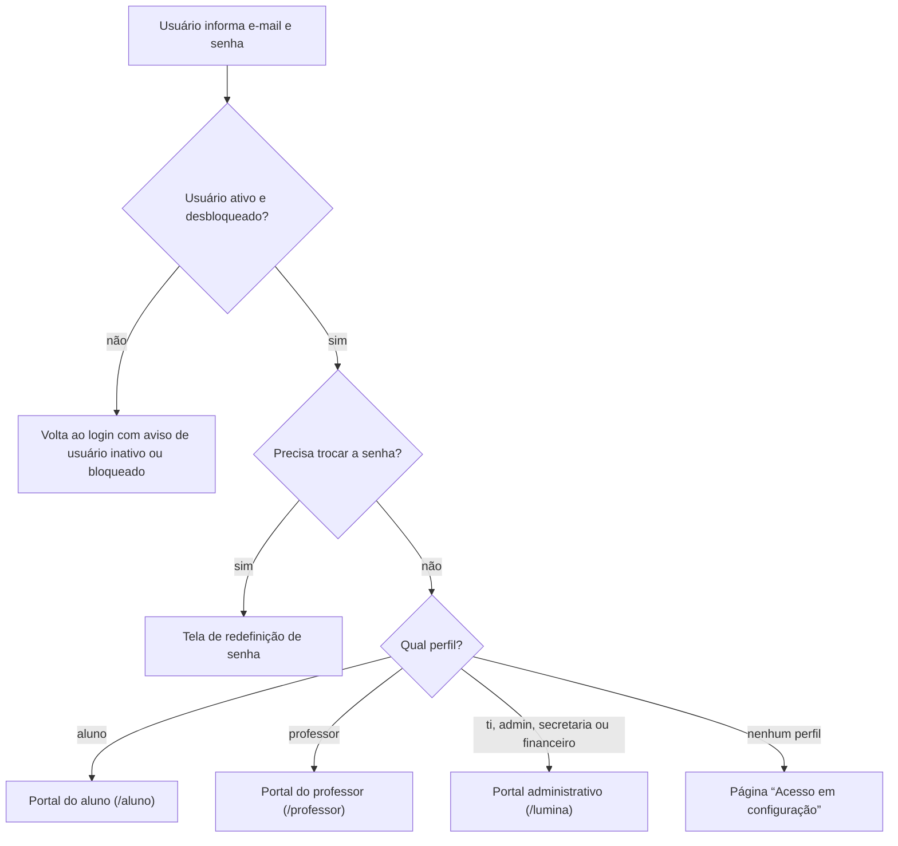
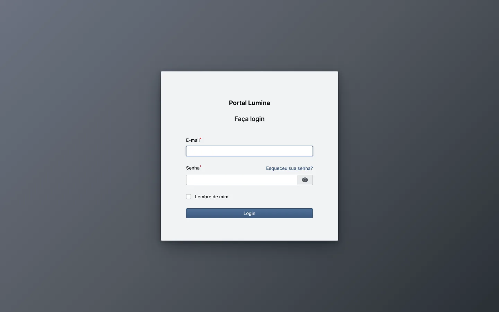
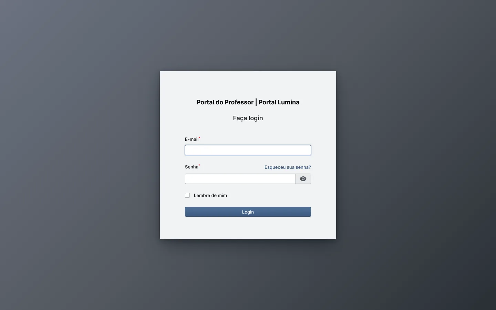
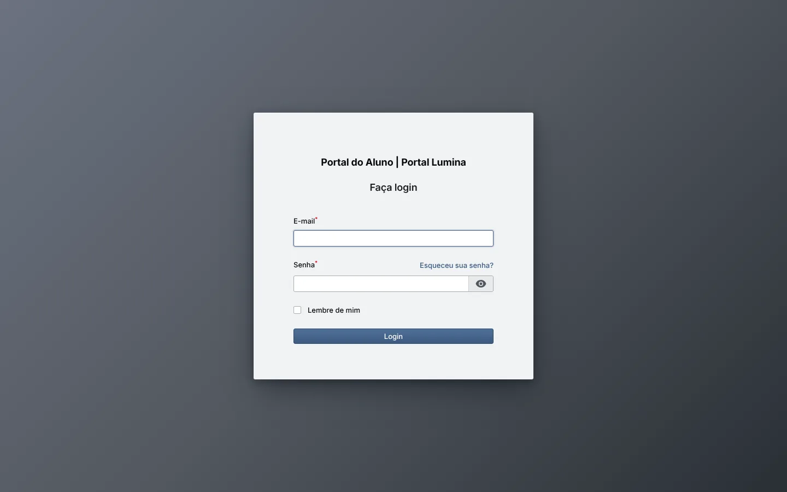
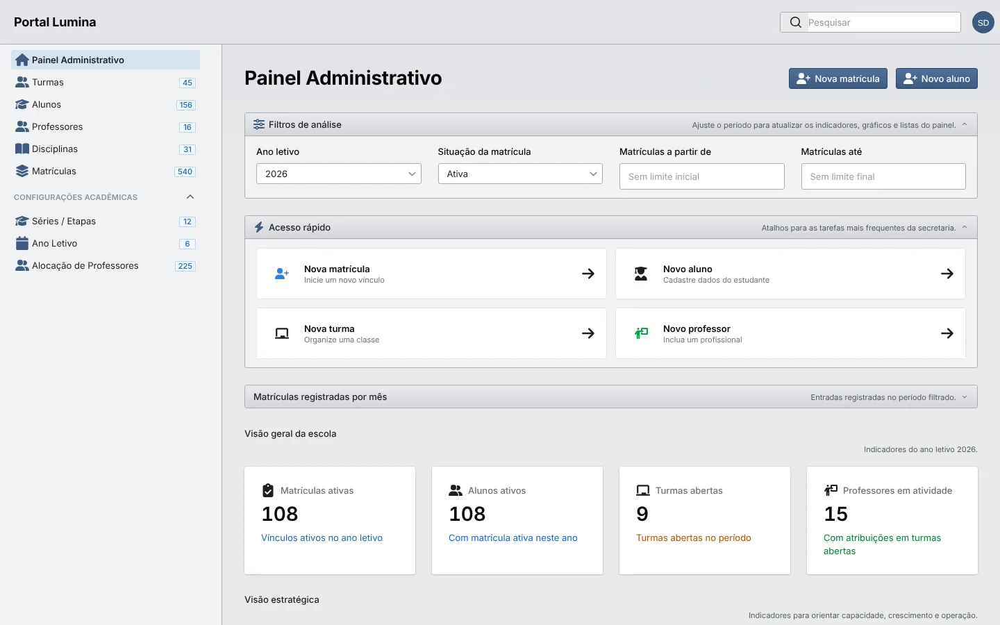
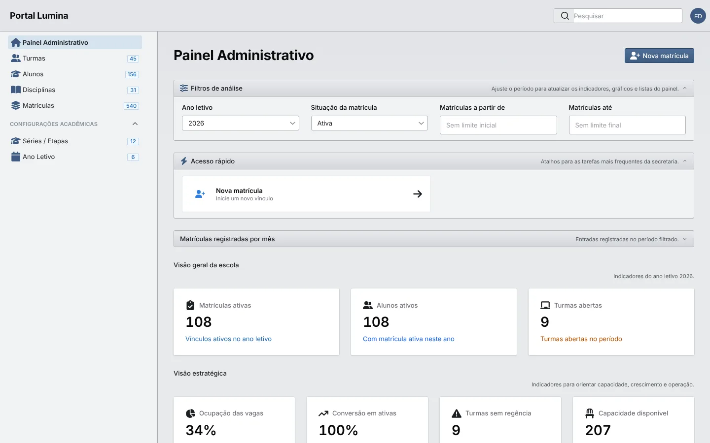

# Atores, perfis e portais

> Quem usa o Lumina ERP, por qual portal entra e o que cada perfil enxerga no menu. Comece por aqui e depois siga para o manual do seu portal.

## 🎯 Objetivo

O Lumina ERP é dividido em **três portais**, cada um com endereço, menu e tema próprios. O portal que a pessoa usa depende do **perfil de acesso** (papel) atribuído ao seu usuário:

| Portal | Endereço | Quem usa | Manual |
| --- | --- | --- | --- |
| Portal administrativo | `/lumina/login` | TI, administração, secretaria e financeiro | [Manual do portal administrativo](./manual-portal-administrativo.md) |
| Portal do professor | `/professor/login` | Professores com alocação ativa | [Manual do portal do professor](./manual-portal-do-professor.md) |
| Portal do aluno | `/aluno/login` | Alunos com cadastro ativo | [Manual do portal do aluno](./manual-portal-do-aluno.md) |

Prints feitos na base de demonstração, com dados sintéticos gerados pelos seeders, e data do sistema fixada em 21/10/2026.

## 👥 Atores do sistema

**[ 📝 CONTEXTO ]** Os perfis abaixo são criados pelo seeder `RolesPermissionsSeeder` e podem ser ajustados em **Administração › Perfis de Acesso** e **Segurança › Permissões de Acesso**.

| Ator | Perfil técnico | Portal | Permissões | Para que serve |
| --- | --- | --- | ---: | --- |
| Equipe de TI | `ti` | Administrativo | 82 | Acesso completo à área administrativa: cadastros, usuários, perfis, permissões e parametrizações do sistema. |
| Administração / direção | `admin` | Administrativo | 82 | Mesmo alcance da TI. É o perfil indicado para quem precisa de acesso master à escola. |
| Secretaria acadêmica | `secretaria` | Administrativo | 59 | Operação do dia a dia: alunos, matrículas, turmas, professores, alocações e relatórios. Não acessa usuários, perfis, permissões nem parametrizações. |
| Financeiro | `financeiro` | Administrativo | 26 | Consulta da área acadêmica e operações de matrícula. As permissões do módulo financeiro já existem no catálogo, mas **ainda não há telas financeiras** no sistema. |
| Professor | `teacher` | Professor | 19 | Turmas, agenda, avaliações, notas e frequência das turmas e disciplinas em que está alocado. |
| Aluno | `student` | Aluno | 9 | Consulta de notas, boletim, frequência, disciplinas e calendário da própria matrícula ativa. |

> [!NOTE]
> Não existe um perfil específico de **direção** ou **coordenação**: hoje essas pessoas usam o perfil `admin` (acesso total) ou um perfil novo criado em **Perfis de Acesso**. O catálogo também tem um módulo **Responsável** (6 permissões), ainda sem portal nem perfil associado.

## 🔐 Como o acesso funciona

**[ 🖼️ VISUALIZAÇÃO ]** Caminho de um usuário desde o login até o painel do seu perfil.

**[ 📢 REGRA DE NEGÓCIO ]** **RN-ACE-001 — Condições para entrar em cada portal**

| Portal | Condição para acessar |
| --- | --- |
| Administrativo | Usuário ativo, desbloqueado e com perfil `ti`, `admin`, `secretaria` ou `financeiro`. |
| Professor | Usuário ativo, perfil `teacher` e cadastro de professor com status **Ativo** e sem data de desligamento. |
| Aluno | Usuário ativo, perfil `student` e cadastro de aluno com status **Ativo**. |

Onde: `User::canAccessPanel`, `EnsureUserIsActive`, `EnsurePasswordWasChanged`, `AdministrativeDashboardAccess`.

**[ 📢 REGRA DE NEGÓCIO ]** **RN-ACE-002 — Primeiro acesso por convite**
Alunos e professores recebem o acesso a partir do cadastro. Na etapa **Acesso ao portal** da matrícula (aluno) e no campo **Ação de acesso** do cadastro do professor, a secretaria escolhe entre **Não criar acesso agora**, **Criar usuário sem enviar convite** ou **Criar usuário e enviar convite**. As listas de Alunos, Professores e Usuários também têm a ação de enviar ou reenviar o convite, que leva a pessoa a definir a própria senha. Usuários marcados com **Forçar troca de senha** são levados à redefinição antes de entrar.

> [!IMPORTANT]
> Na instalação de demonstração os e-mails vão para o log (`MAIL_MAILER=log`), então convites e recuperações de senha não chegam a uma caixa de entrada real.

### Tela de login

As três telas de login têm o mesmo formato: e-mail, senha, **Lembre de mim** e o link **Esqueceu sua senha?**.

| Portal administrativo | Portal do professor | Portal do aluno |
| --- | --- | --- |
|  |  |  |

## 🗂️ Menus por perfil

O menu lateral mostra apenas o que o perfil pode usar. Os números ao lado de cada item do portal administrativo indicam a quantidade de registros.

### Portal administrativo

| Grupo | Menu | TI / Admin | Secretaria | Financeiro |
| --- | --- | :---: | :---: | :---: |
| — | Painel Administrativo | ✅ | ✅ | ✅ |
| — | Turmas | ✅ | ✅ | ✅ |
| — | Alunos | ✅ | ✅ | ✅ |
| — | Professores | ✅ | ✅ | — |
| — | Disciplinas | ✅ | ✅ | ✅ |
| — | Matrículas | ✅ | ✅ | ✅ |
| Configurações Acadêmicas | Séries / Etapas | ✅ | ✅ | ✅ |
| Configurações Acadêmicas | Ano Letivo | ✅ | ✅ | ✅ |
| Configurações Acadêmicas | Alocação de Professores | ✅ | ✅ | — |
| Administração | Perfis de Acesso | ✅ | — | — |
| Administração | Usuários | ✅ | — | — |
| Administração | Parametrizações do Sistema | ✅ | — | — |
| Segurança | Permissões de Acesso | ✅ | — | — |

Ver o painel com o menu da secretaria e do financeiro

**Secretaria** — sem os grupos Administração e Segurança.

**Financeiro** — sem Professores e Alocação; o atalho do topo mostra só **Nova matrícula**.

### Portal do professor

| Menu | Para que serve |
| --- | --- |
| Portal do Professor | Painel com resumo da semana, pendências e próximas avaliações |
| Minhas Turmas | Cartões das turmas e disciplinas do ano letivo |
| Agenda de Aulas | Grade semanal de aulas |
| Avaliações | Criar, editar e fechar avaliações |
| Lançar Notas | Lançar, salvar rascunho e publicar notas |
| Lançar Frequência | Registrar a chamada de uma aula |
| Meu Perfil | Ver dados e atualizar contato e foto |

### Portal do aluno

| Menu | Para que serve |
| --- | --- |
| Painel do Aluno | Resumo de frequência, média, agenda do dia e últimas notas |
| Minhas Notas | Boletim por bimestre e download em PDF |
| Frequência | Percentual geral, por disciplina e histórico de presença |
| Minhas Disciplinas | Disciplinas da turma com professor, notas e frequência |
| Calendário | Avaliações, feriados, recessos e eventos do ano letivo |

## 🔗 Referências

- [Manual do portal administrativo](./manual-portal-administrativo.md)
- [Manual do portal do professor](./manual-portal-do-professor.md)
- [Manual do portal do aluno](./manual-portal-do-aluno.md)
- [Permissões diretas excepcionais](../02-guias/permissoes-diretas.md)
- [Portal do aluno — regras técnicas](./portal-do-aluno.md)
