# Manual do portal administrativo

> Guia de uso do site administrativo do Lumina (`/lumina`), com o que cada menu faz e o passo a passo das tarefas mais comuns da secretaria.

## 🎯 Objetivo

O portal administrativo é a área de gestão da escola. Ele permite que a **equipe de TI**, a **administração/direção** e a **secretaria acadêmica** cadastrem a estrutura escolar, alunos, professores e matrículas, e que a TI controle usuários, perfis e permissões. Os perfis `ti` e `admin` têm acesso master; `secretaria` e `financeiro` veem um menu reduzido, conforme a tabela de [menus por perfil](./atores-e-perfis.md).

**Endereço:** `/lumina/login` · **Perfis:** `ti`, `admin`, `secretaria`, `financeiro`

Prints da base de demonstração, com dados sintéticos e data do sistema fixada em 21/10/2026. Os números nos menus e nos indicadores variam conforme a base.

## 🔄 Ordem de implantação

**[ 📝 CONTEXTO ]** Os cadastros dependem uns dos outros. Em uma escola nova, siga esta ordem para não travar em campos obrigatórios:

**[ 🖼️ VISUALIZAÇÃO ]** Sequência recomendada de configuração.

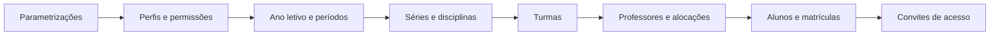

| Passo | Menu | O que fazer |
| ---: | --- | --- |
| 1 | Administração › Parametrizações do Sistema | Nome da instituição, logos, cor e formatos de numeração |
| 2 | Administração › Perfis de Acesso e Segurança › Permissões de Acesso | Revisar o que cada perfil pode fazer |
| 3 | Configurações Acadêmicas › Ano Letivo | Criar o ano, as datas e os períodos avaliativos (bimestres) |
| 4 | Configurações Acadêmicas › Séries / Etapas e Disciplinas | Cadastrar disciplinas e vinculá-las a cada série |
| 5 | Turmas | Criar as turmas do ano letivo com turno e capacidade |
| 6 | Professores e Configurações Acadêmicas › Alocação de Professores | Cadastrar professores e ligar cada um a turma + disciplina |
| 7 | Matrículas | Matricular alunos novos ou já cadastrados |
| 8 | Alunos, Professores ou Usuários | Enviar convites de acesso aos portais |

## 🖼️ Painel Administrativo

Primeira tela após o login. Reúne filtros, atalhos e indicadores do ano letivo.

**[ 🖼️ VISUALIZAÇÃO ]**

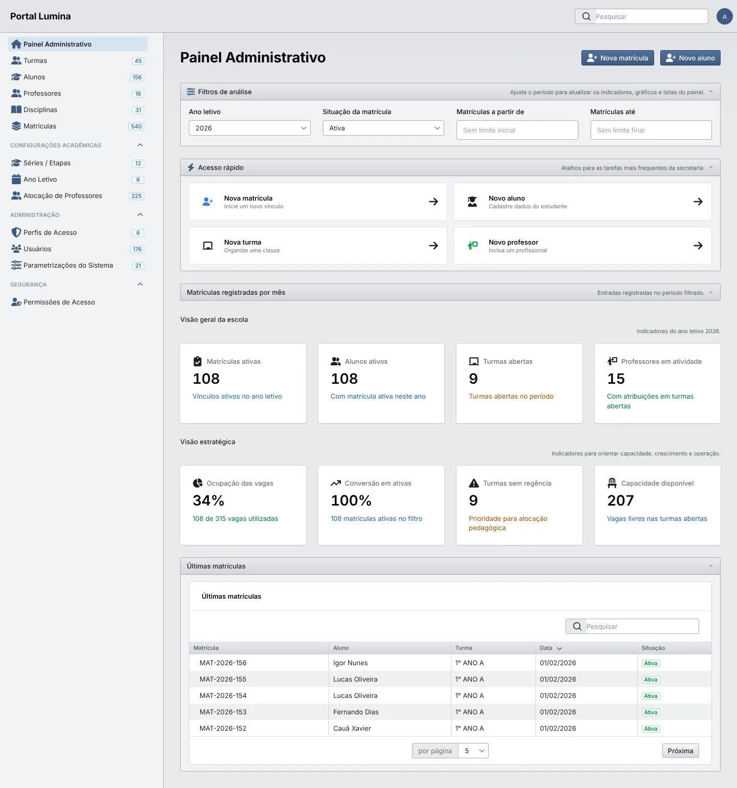

| Área | O que mostra |
| --- | --- |
| Botões do topo | **Nova matrícula** e **Novo aluno** |
| Filtros de análise | Ano letivo, situação da matrícula e período; atualizam indicadores, gráfico e listas |
| Acesso rápido | Atalhos para nova matrícula, novo aluno, nova turma e novo professor |
| Matrículas registradas por mês | Gráfico de entradas no período filtrado (seção recolhível) |
| Visão geral da escola | Matrículas ativas, alunos ativos, turmas abertas e professores em atividade |
| Visão estratégica | Ocupação das vagas, conversão em ativas, turmas sem regência e capacidade disponível |
| Últimas matrículas | Lista das matrículas mais recentes com situação |

> [!TIP]
> **Turmas sem regência** conta as turmas abertas sem **Professor Responsável** definido no cadastro da turma. Vale conferir antes do início das aulas.

## 🗃️ Menu principal

### Turmas

Lista as turmas com código, série, ano letivo, turno, tipo, status, professor responsável, ocupação e vagas restantes.

**[ 🖼️ VISUALIZAÇÃO ]**

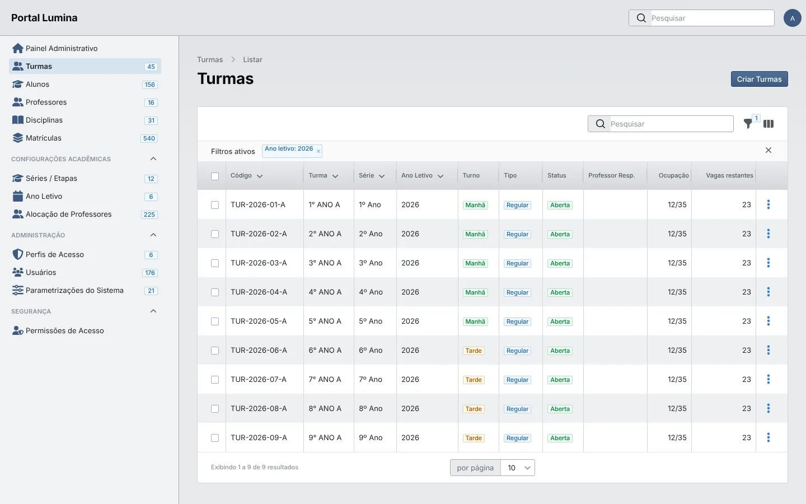

| Ação | Onde | Efeito |
| --- | --- | --- |
| Criar Turmas | Topo da lista | Abre o cadastro de turma |
| Ver turma / Editar | Menu de ações da linha | Abre os dados da turma |
| Matricular aluno | Menu de ações da linha | Inicia uma matrícula já nessa turma |
| Ver disciplinas | Menu de ações da linha | Mostra as disciplinas ofertadas na turma |

Ao editar uma turma, as abas **Alunos matriculados** e **Disciplinas da Turma** mostram quem está na turma e o que é ofertado. Em cada aluno há **Ver aluno**, **Editar matrícula** e **Remover da turma**.

Ver as telas de cadastro e edição de turma

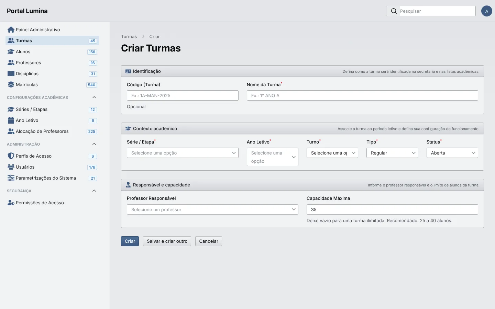

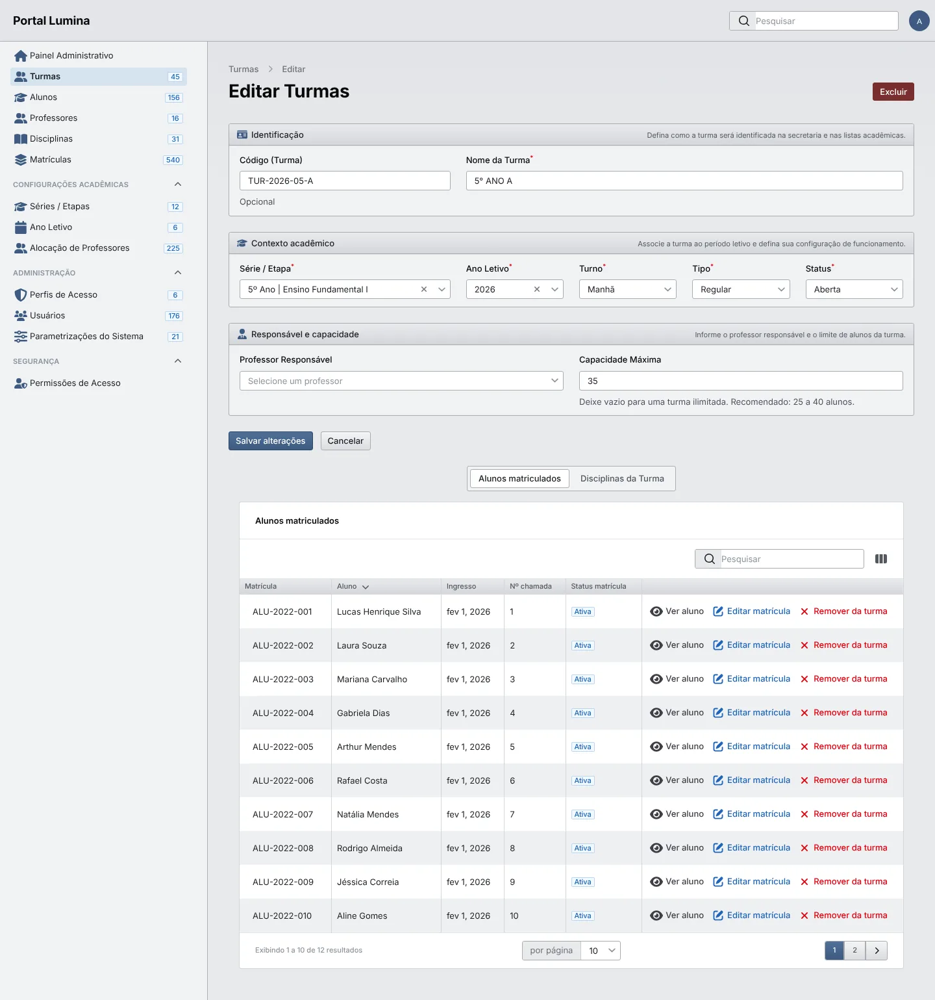

**[ 📢 REGRA DE NEGÓCIO ]** **Capacidade máxima** limita as matrículas que ocupam vaga. Deixe vazio para turma sem limite; o sistema recomenda de 25 a 40 alunos.

### Alunos

Cadastro dos estudantes, com matrícula, idade, turma atual, contatos, status e situação de **Onboarding** (sem usuário, sem matrícula, completo ou inconsistente).

**[ 🖼️ VISUALIZAÇÃO ]**

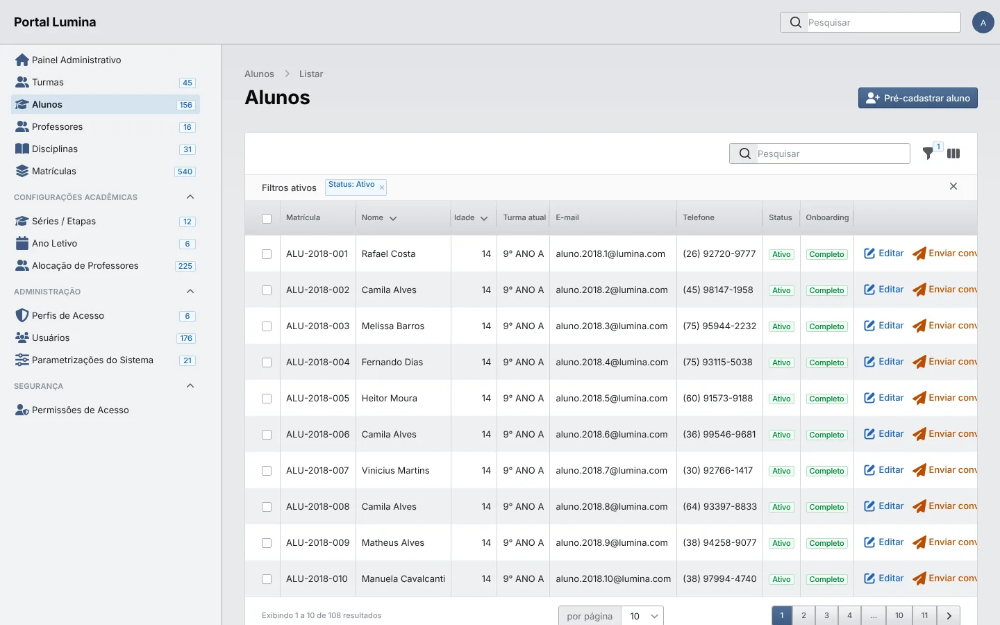

| Ação | Efeito |
| --- | --- |
| Pré-cadastrar aluno | Cria o cadastro sem matrícula |
| Editar | Abre o cadastro completo e o histórico de matrículas |
| Enviar convite | Envia o convite de acesso ao portal do aluno |
| Matricular aluno | Inicia a matrícula do aluno selecionado |
| Alterar status (selecionados) | Ação em lote para vários alunos |

O cadastro tem as seções **Identificação**, **Foto**, **Contato & Endereço**, **Nascimento & Nacionalidade**, **Responsáveis**, **Situação do aluno** e **Saúde & Transporte**. Na edição aparece também **Matrículas / Turmas**, com o histórico do aluno.

Ver as telas de pré-cadastro e edição de aluno

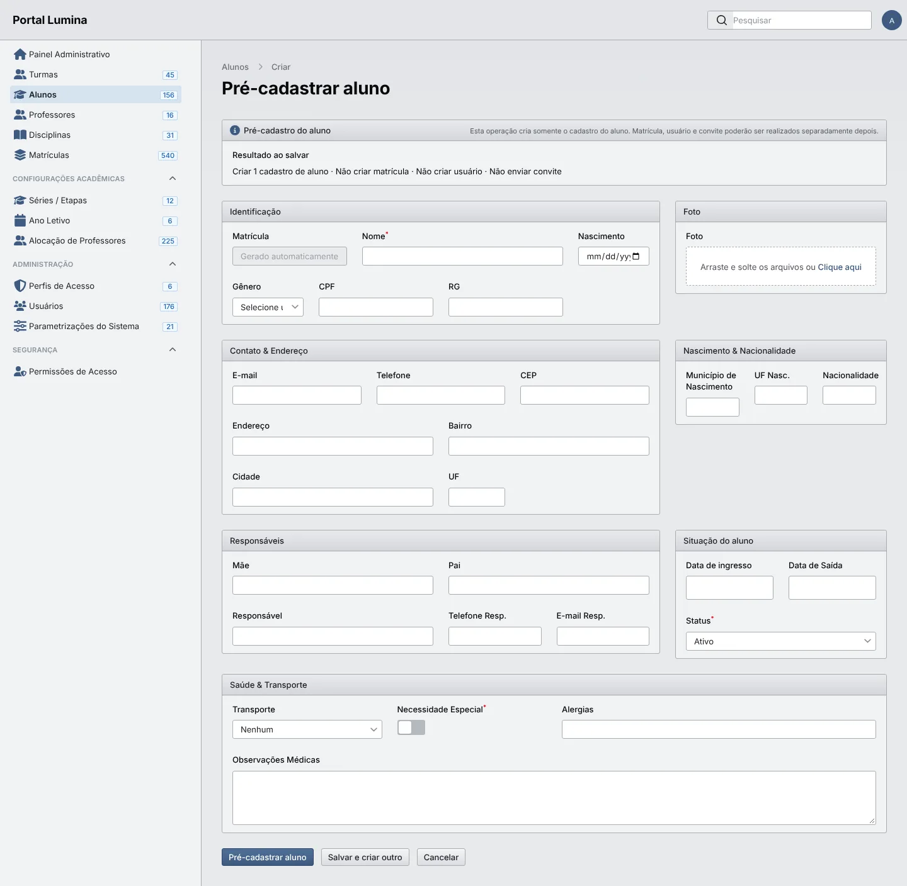

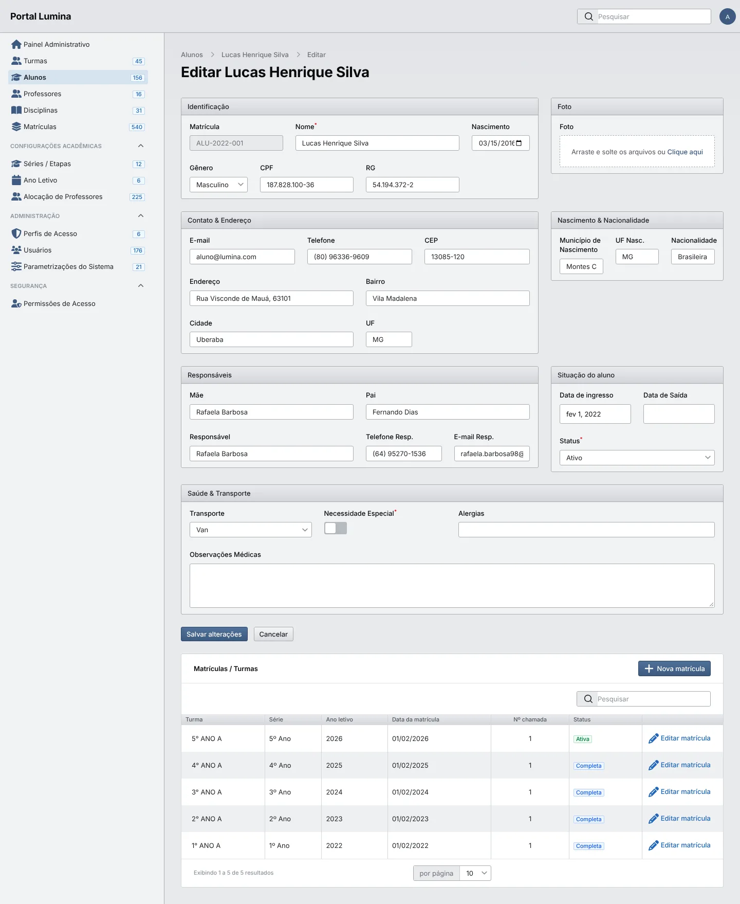

> [!TIP]
> Para aluno novo, prefira **Matrículas › Matricular aluno › Novo aluno**: o cadastro, a matrícula e o acesso ao portal são feitos em um único fluxo.

### Professores

Cadastro dos docentes com matrícula funcional, contatos, carga horária, status e **Onboarding** (sem usuário, sem alocação, pronto para acesso ou acesso bloqueado). Visível para TI, admin e secretaria.

**[ 🖼️ VISUALIZAÇÃO ]**

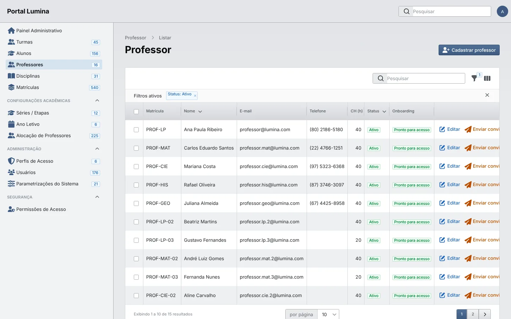

| Ação | Efeito |
| --- | --- |
| Cadastrar professor | Abre o cadastro, com a escolha de **Ação de acesso** e as turmas e disciplinas |
| Editar | Dados pessoais, formação, contato, vínculo e a aba **Turmas & Disciplinas** |
| Enviar convite | Envia o convite de acesso ao portal do professor |
| Adicionar alocação | Liga o professor a uma turma e disciplina |
| Alterar status | Ativo, Inativo, Afastado ou Desligado |

Ver as telas de cadastro e edição de professor

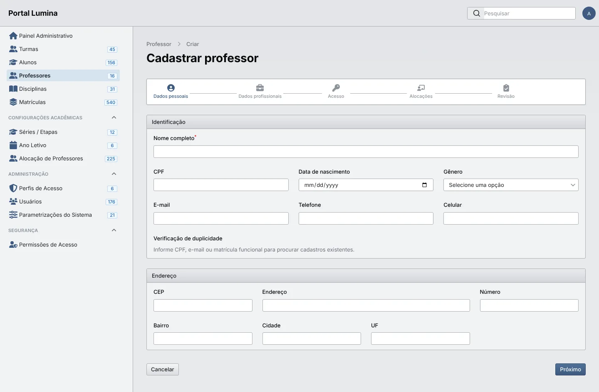

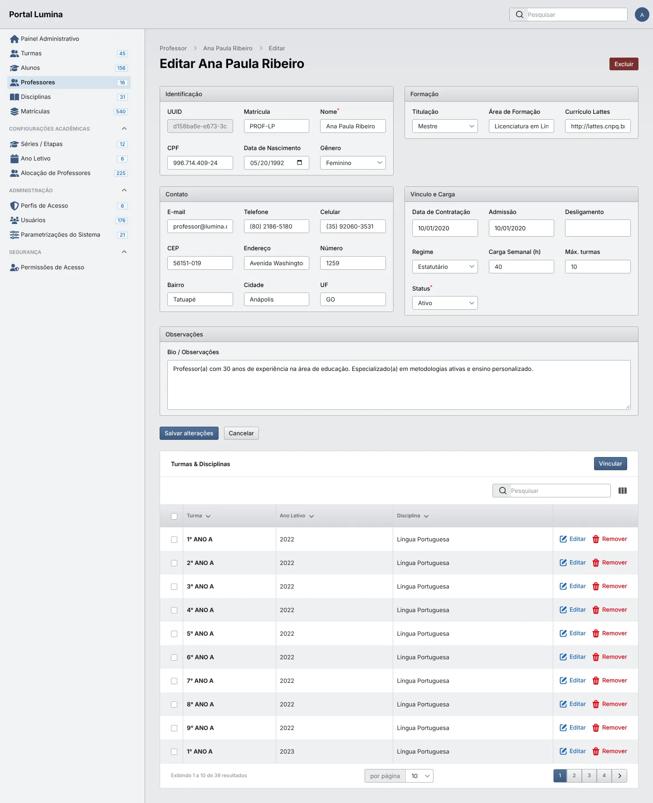

**[ 📢 REGRA DE NEGÓCIO ]** Só entra no portal do professor quem tem status **Ativo** e não tem data de desligamento.

### Disciplinas

Catálogo de disciplinas com código, componente curricular, status e séries em que são ofertadas.

**[ 🖼️ VISUALIZAÇÃO ]**

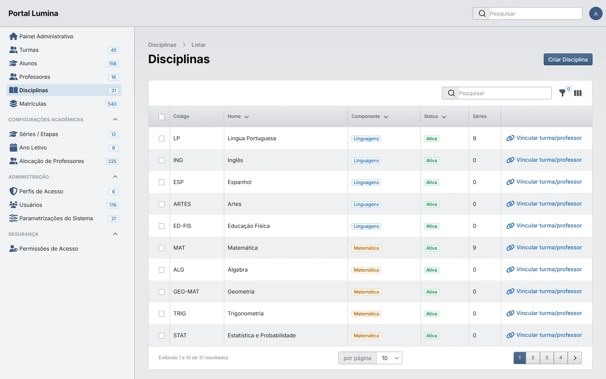

| Ação | Efeito |
| --- | --- |
| Criar Disciplina | Código, nome, componente curricular, status, código e referência BNCC, tags e descrição |
| Ofertar em turma (sem professor) | Inclui a disciplina na turma antes de definir o docente |
| Vincular turma/professor | Cria a oferta já com o professor |
| Alterar status | Ativa ou inativa a disciplina |

Ver a edição de disciplina

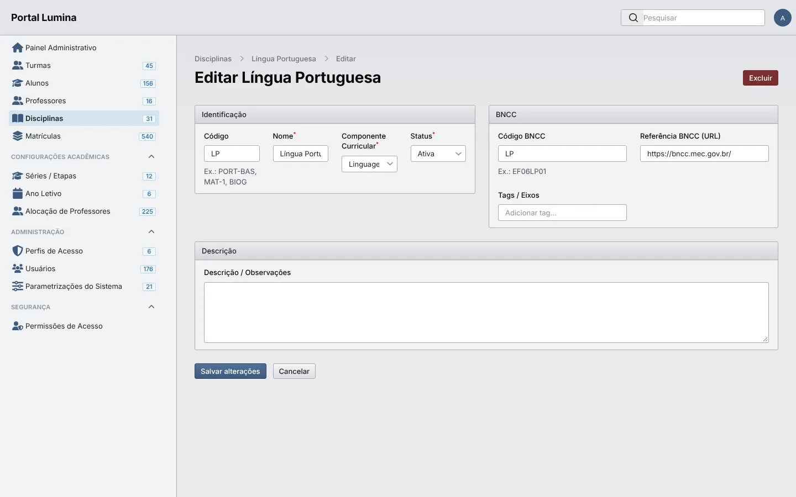

### Matrículas

Centro da operação da secretaria. Os cartões do topo resumem o ano letivo atual: total, ativas, trancadas, canceladas, transferidas e concluídas.

**[ 🖼️ VISUALIZAÇÃO ]**

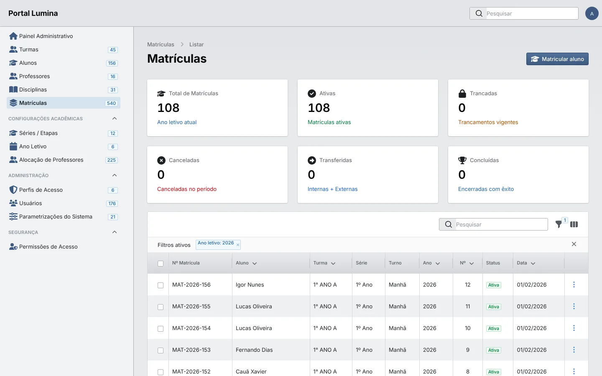

| Ação | Onde | Efeito |
| --- | --- | --- |
| Matricular aluno | Topo | Abre o assistente de matrícula |
| Ver detalhes / Editar | Linha | Dados da matrícula, histórico e documentos |
| Emitir Comprovante | Linha | Gera o comprovante em PDF |
| Trancar, Transferir Turma, Transferência Externa, Cancelar | Linha | Mudam o status e registram o histórico |
| Rematrícula em Lote, Alterar status | Seleção de várias linhas | Operações em lote |

**[ 📢 REGRA DE NEGÓCIO ]** O aluno pode ter só **uma matrícula ativa por ano letivo**, e o histórico nunca é apagado. Regras completas em [Regras de matrícula](./matriculas.md).

## 🛠️ Configurações acadêmicas

### Séries / Etapas

Séries do ensino (por exemplo, 1º ao 9º ano) com etapa e ordem de exibição. Na edição, a área **Disciplinas da Série** define quais disciplinas compõem o currículo e quantas aulas por semana cada uma tem (**Adicionar disciplina(s)**).

**[ 🖼️ VISUALIZAÇÃO ]**

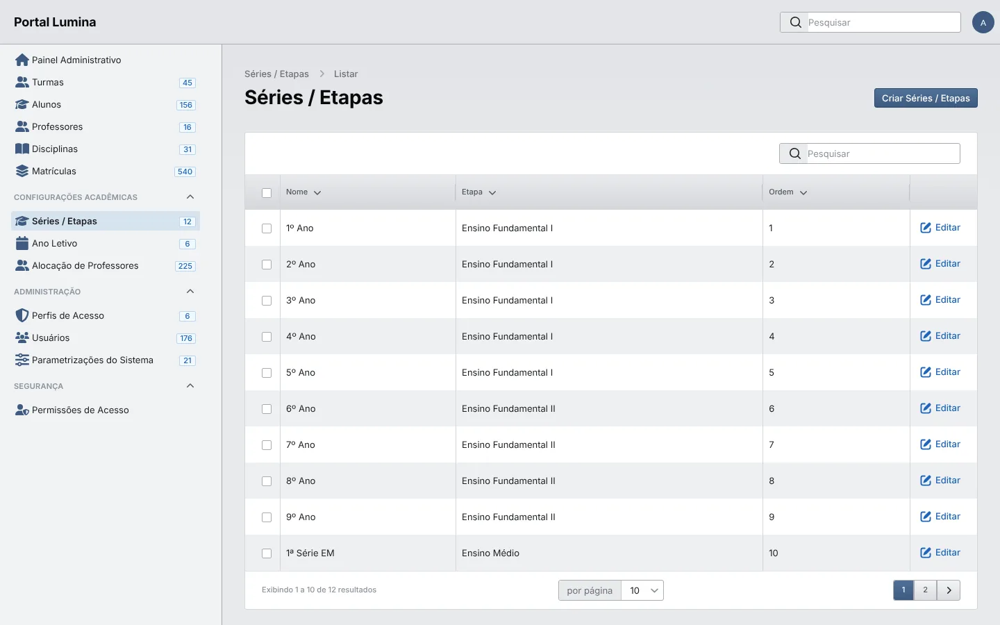

Ver a edição de série com disciplinas

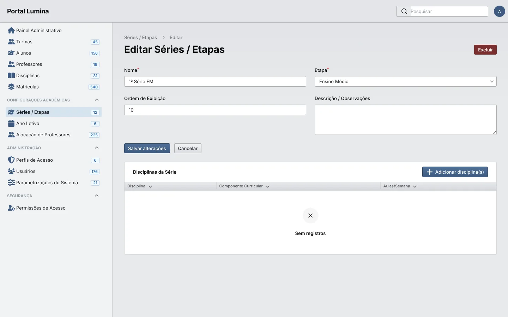

### Ano Letivo

Anos letivos com início, fim, quantidade de períodos e status (**Planejamento**, **Ativo** ou **Encerrado**).

**[ 🖼️ VISUALIZAÇÃO ]**

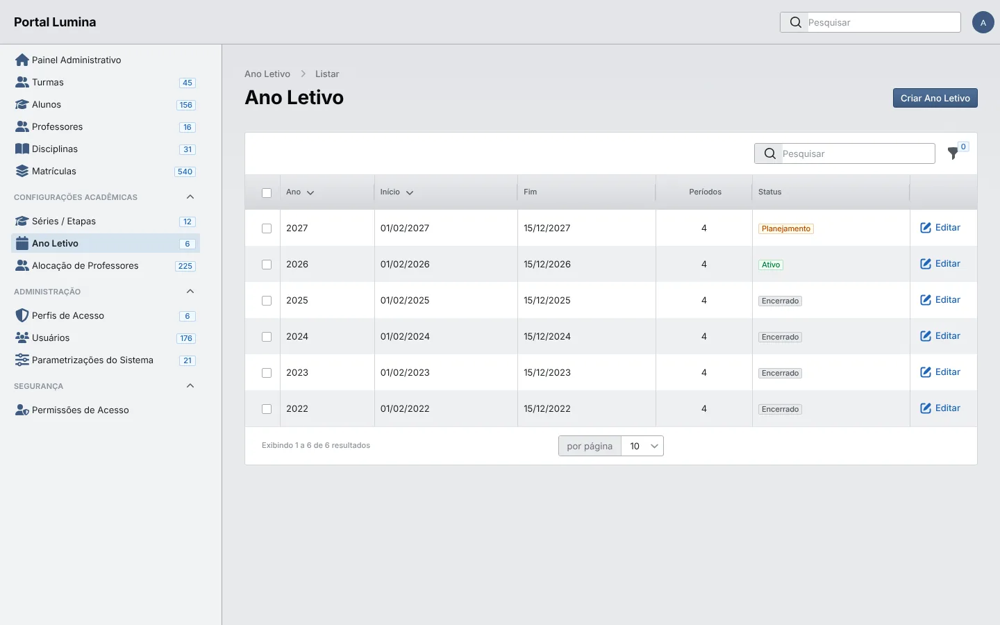

Na edição, a tabela **Períodos Avaliativos** cadastra os bimestres com datas do período, janela de lançamento de notas e indicação de publicação (**Criar Período**).

Ver a edição do ano letivo e dos períodos

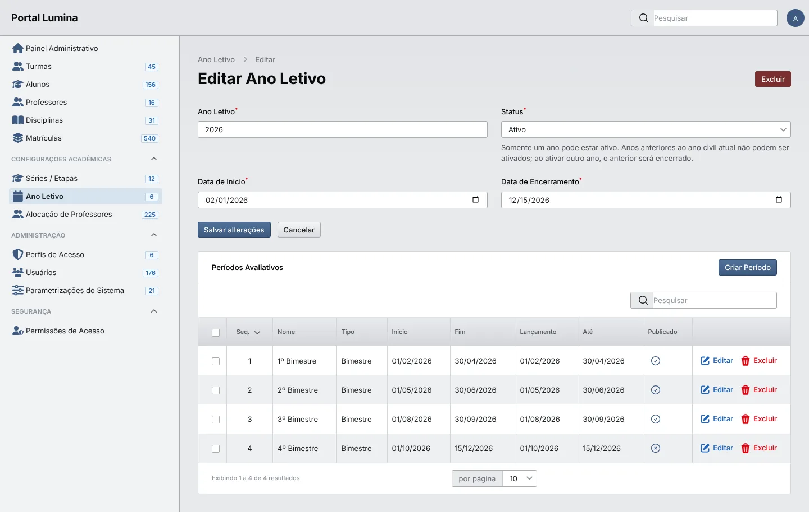

**[ 📢 REGRA DE NEGÓCIO ]** Só um ano letivo fica **Ativo** por vez, e um ano **Encerrado** não aceita novas matrículas.

### Alocação de Professores

Liga **turma + professor + disciplina**. É essa alocação que libera a turma no portal do professor.

**[ 🖼️ VISUALIZAÇÃO ]**

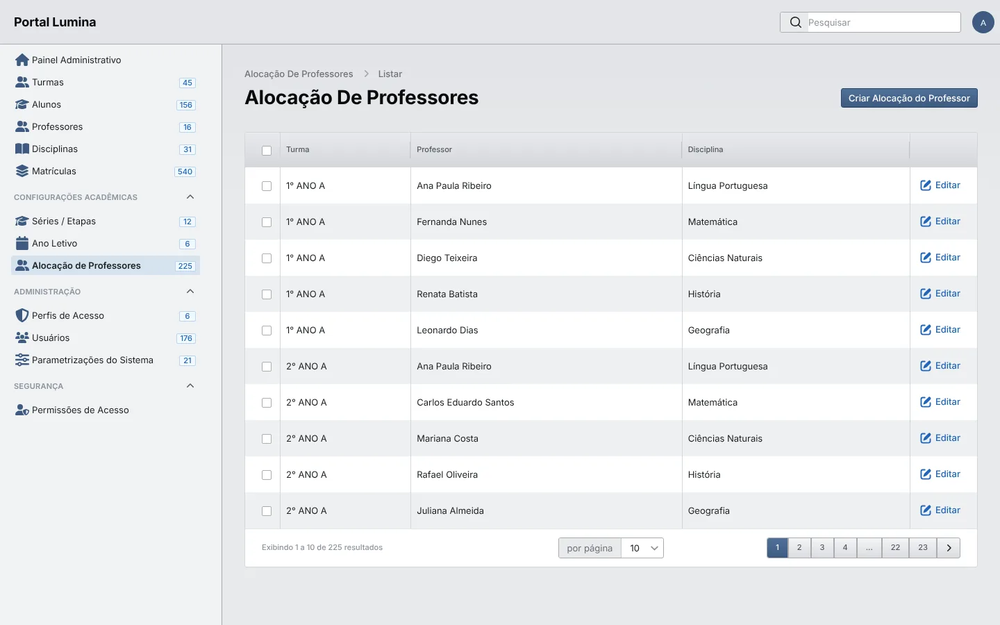

Ao criar, informe turma, professor e disciplina. A opção **Autorizar exceção curricular** permite escolher uma disciplina fora da matriz da série.

Ver o cadastro de alocação

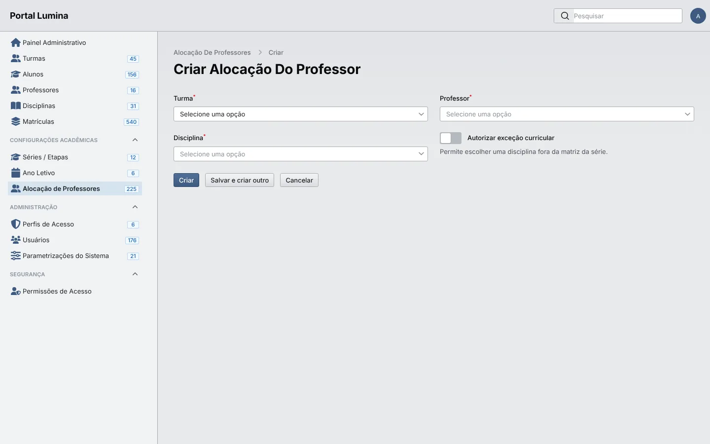

## ⚙️ Administração

Grupo visível apenas para os perfis `ti` e `admin`.

### Perfis de Acesso

Lista os perfis (`ti`, `admin`, `secretaria`, `financeiro`, `teacher`, `student`) com a quantidade de permissões. **Criar Perfil de Acesso** permite montar um perfil novo, como um perfil de coordenação.

**[ 🖼️ VISUALIZAÇÃO ]**

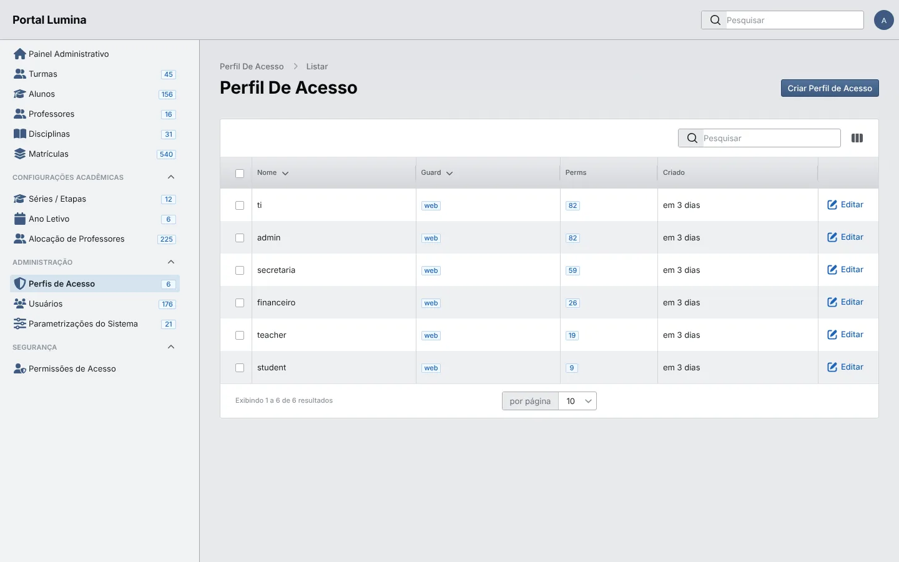

Ver a edição de perfil

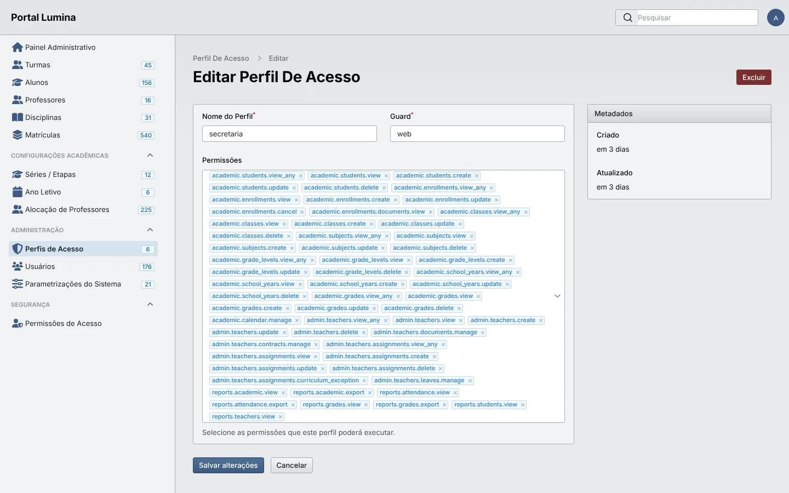

### Usuários

Contas de login de todos os perfis. Os cartões do topo mostram usuários ativos, bloqueados, aguardando troca de senha e a divisão por grupo (TI/Admin, Secretaria/Financeiro, Professores e Alunos).

**[ 🖼️ VISUALIZAÇÃO ]**

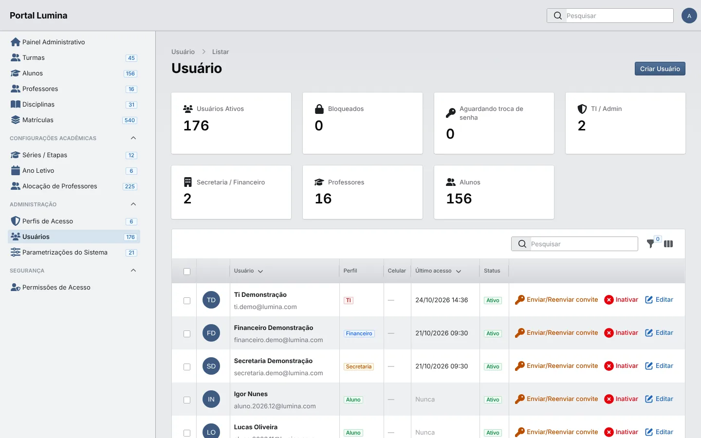

| Ação | Efeito |
| --- | --- |
| Criar Usuário | Nome, e-mail institucional, perfil, **Ativo** e **Forçar troca de senha** |
| Enviar/Reenviar convite | Envia o link para definir a senha |
| Inativar / Reativar | Bloqueia ou libera o login (também em lote) |
| Editar | Dados pessoais, endereço e contato |

Ver o cadastro de usuário

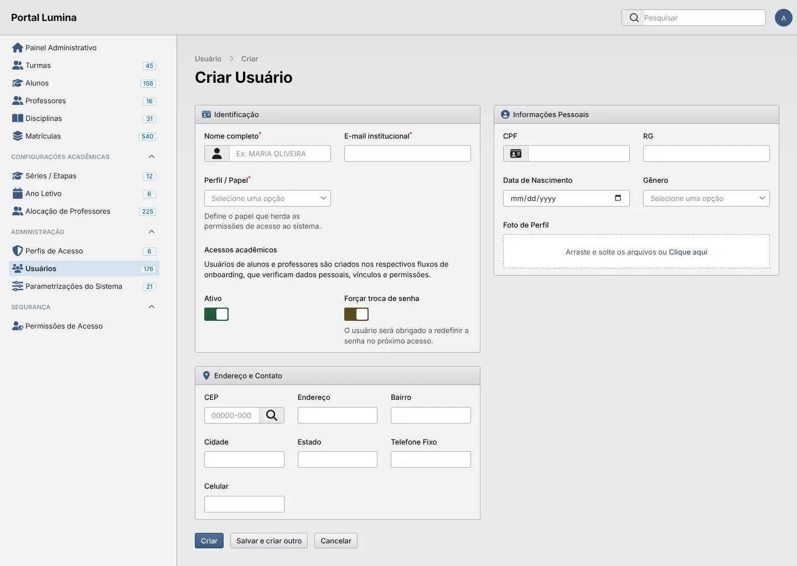

> [!NOTE]
> Use **Criar Usuário** para a equipe administrativa. Professores e alunos devem ganhar acesso pelo próprio cadastro ou matrícula, para que o usuário fique ligado ao registro correto.

### Parametrizações do Sistema

Configurações gerais, agrupadas por categoria: identidade (nome da instituição, logos, cor institucional, nome do sistema), formatos de numeração (matrícula, aluno, turma, matrícula funcional) e regras de cadastro, como **Permitir matrícula sem responsável**. Cada item tem apenas a ação **Editar**.

**[ 🖼️ VISUALIZAÇÃO ]**

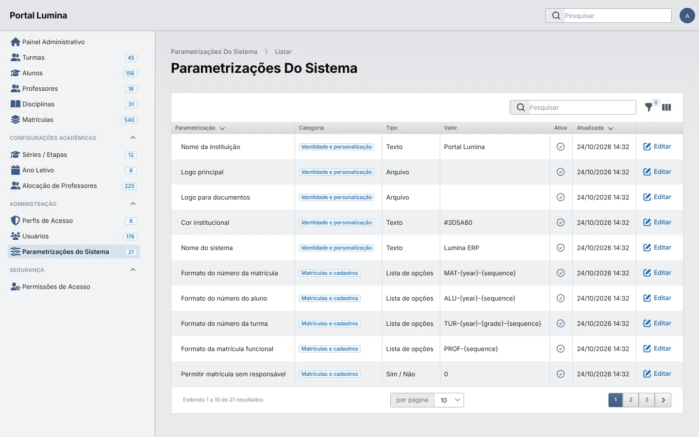

## 🔐 Segurança

### Permissões de Acesso

Matriz de permissões por perfil. Escolha o perfil em **Perfil selecionado**, filtre por nome ou situação e ligue ou desligue cada permissão nas abas por módulo (Financeiro, Portal do Aluno, Portal do Professor, Professores - Administrativo, Relatórios, Responsável, Secretaria Acadêmica e Sistema). Cada aba tem **Marcar todas**, **Somente leitura** e **Desmarcar todas**. Nada muda até clicar em **Salvar alterações**.

**[ 🖼️ VISUALIZAÇÃO ]**

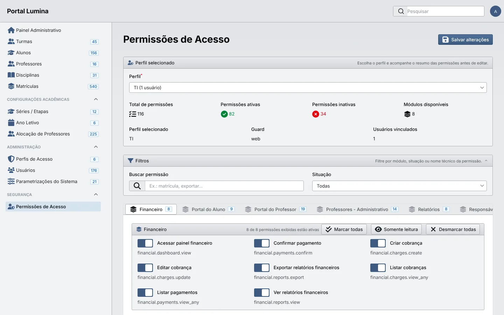

> [!WARNING]
> Mudanças aqui valem para **todos** os usuários do perfil. Para uma exceção de uma só pessoa, siga o guia de [permissões diretas excepcionais](../02-guias/permissoes-diretas.md).

## ▶️ Tarefas do dia a dia

### Matricular um aluno

1. Em **Matrículas**, clique em **Matricular aluno** (ou use **Nova matrícula** no painel).
2. **Identificação do aluno:** escolha **Aluno já cadastrado no sistema** e busque por nome, matrícula ou CPF, ou **Novo aluno | preencher cadastro** para cadastrar na hora.
3. **Dados da matrícula:** ano letivo, turma, data da matrícula, número de chamada (sugerido automaticamente) e status.
4. **Acesso ao portal:** escolha se o sistema cria o usuário do aluno e se envia o convite.
5. **Revisão:** confira os dados e conclua.

**[ 🖼️ VISUALIZAÇÃO ]** Primeira etapa do assistente.

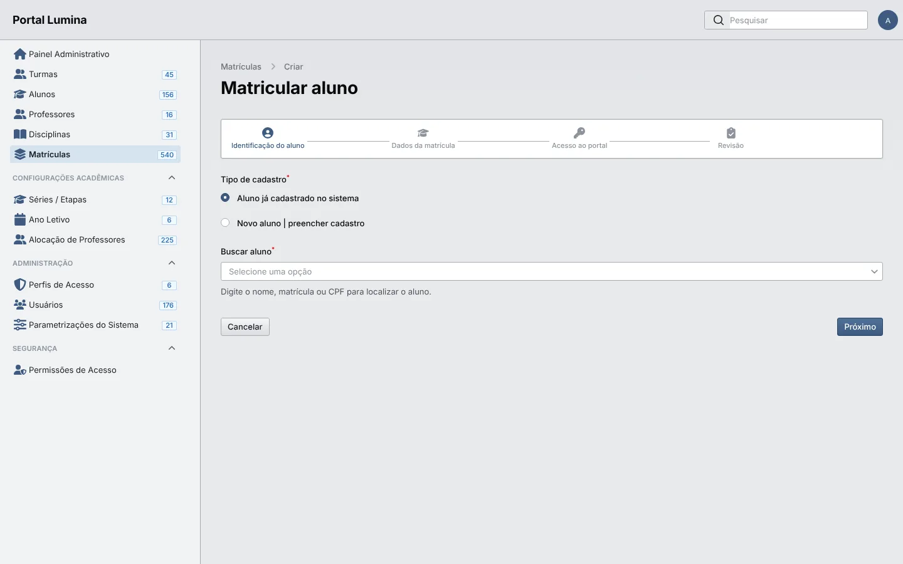

Resultado esperado: a matrícula aparece como **Ativa**, a ocupação da turma aumenta e o histórico registra a criação. Se a turma estiver cheia ou o ano letivo encerrado, o sistema recusa e explica o motivo.

### Trancar, transferir ou cancelar uma matrícula

1. Abra a matrícula em **Matrículas › Editar**.
2. Clique em **Operações** e escolha **Trancar Matrícula**, **Transferir Turma**, **Transferência Externa** ou **Cancelar Matrícula**.
3. Preencha os dados pedidos no formulário (turma de destino, motivo ou observação) e confirme.

**[ 🖼️ VISUALIZAÇÃO ]**

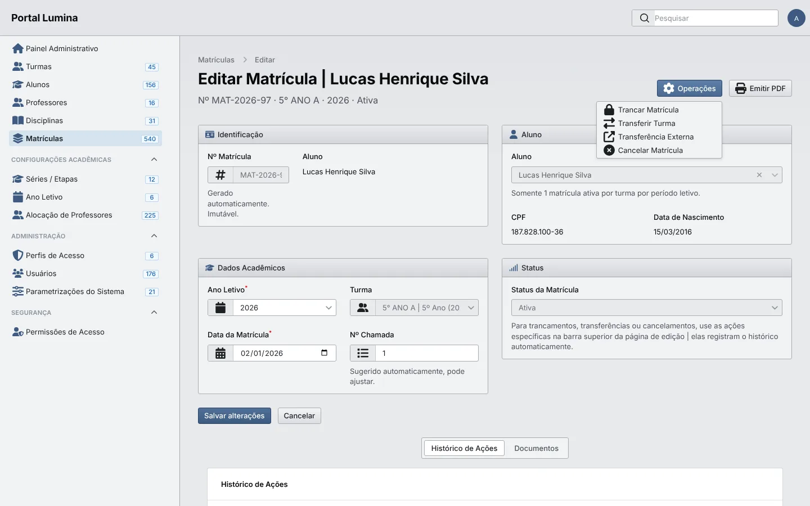

> [!IMPORTANT]
> Não troque o status direto no campo **Status da Matrícula**: use sempre **Operações**. As operações registram o histórico na aba **Histórico de Ações** e liberam ou ocupam a vaga corretamente.

Ver a matrícula com histórico de ações

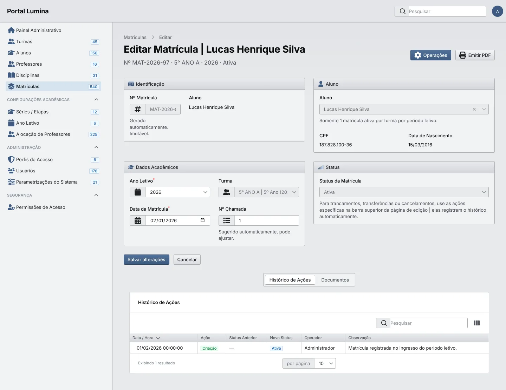

### Emitir comprovante de matrícula

Na lista de **Matrículas**, use **Emitir Comprovante** na linha, ou **Emitir PDF** dentro da matrícula. Os documentos emitidos ficam na aba **Documentos**.

### Preparar um professor para o portal

1. Cadastre o professor em **Professores › Cadastrar professor**, com status **Ativo**.
2. Em **Ação de acesso**, escolha **Criar usuário e enviar convite**.
3. Faça a alocação em **Adicionar alocação** ou em **Alocação de Professores**.
4. Confira na lista que o onboarding mudou para **Pronto para acesso**.

## ⚠️ Limitações conhecidas

- O perfil **Financeiro** existe, mas ainda não há telas financeiras (cobranças, pagamentos).
- Convites e recuperação de senha só chegam por e-mail com um provedor real configurado; na demonstração, vão para o log.
- Não há perfil próprio para direção ou coordenação; crie um em **Perfis de Acesso** se necessário.

## 🔗 Referências

- [Atores, perfis e portais](./atores-e-perfis.md)
- [Regras de matrícula](./matriculas.md)
- [Permissões diretas excepcionais](../02-guias/permissoes-diretas.md)
- [Modelo relacional](../03-arquitetura/modelo-relacional.md)
