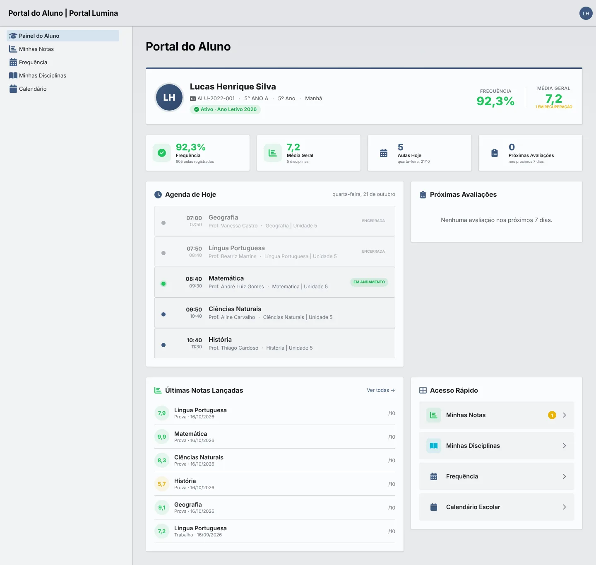
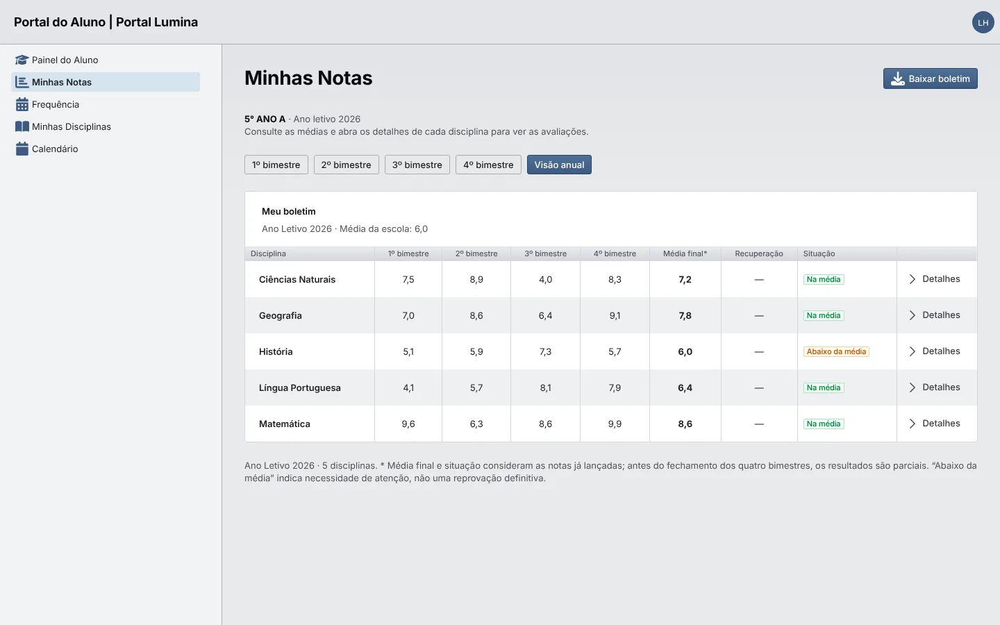
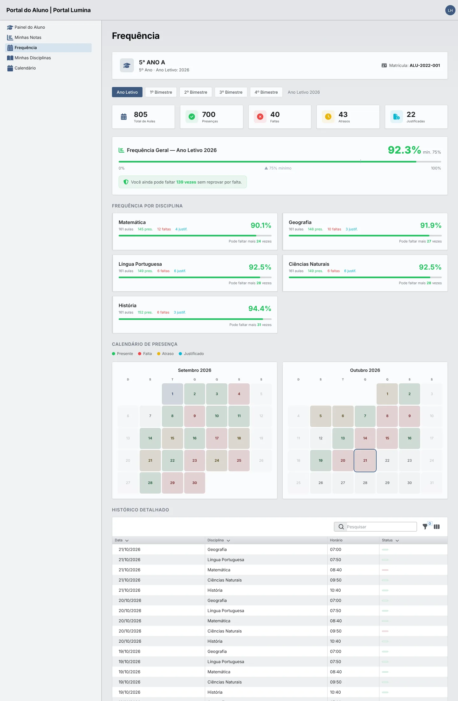
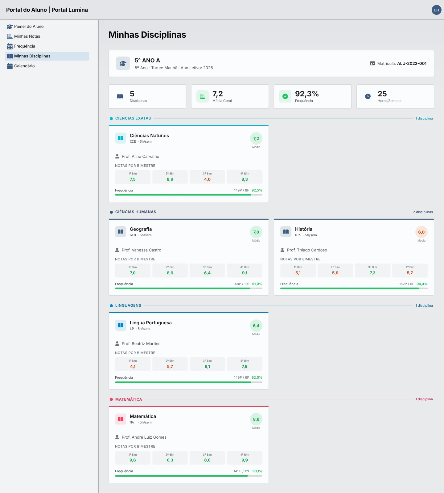
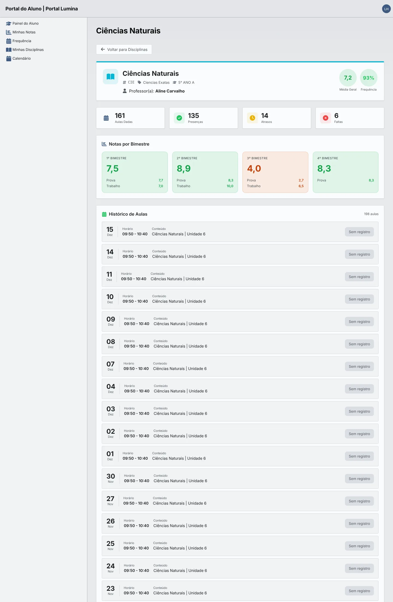
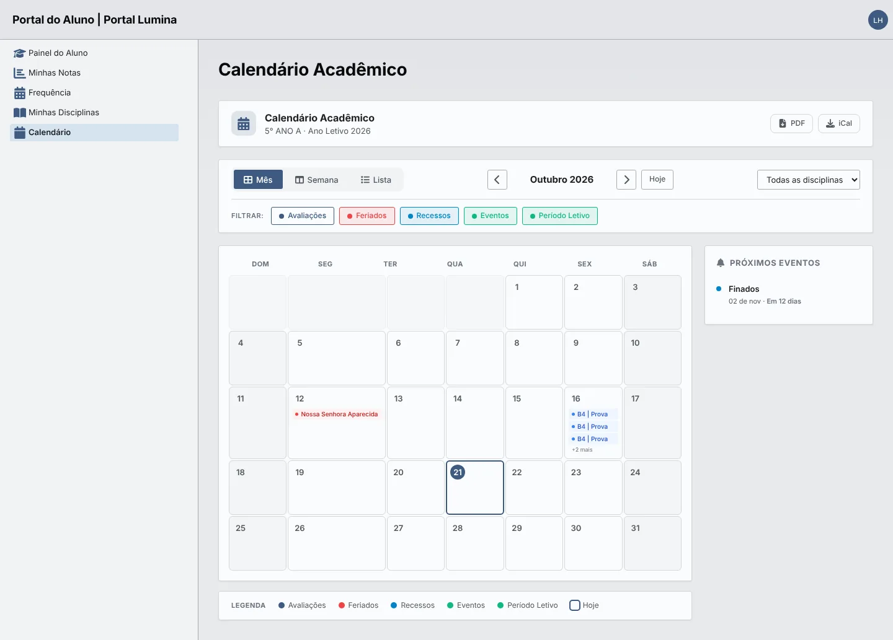

# Manual do portal do aluno

> Guia de uso do portal do aluno (`/aluno`): painel, boletim, frequência, disciplinas e calendário. Para as regras técnicas do módulo, veja [Portal do aluno](./portal-do-aluno.md).

## 🎯 Objetivo

O portal do aluno é uma área de **consulta**: o estudante acompanha a própria vida acadêmica no ano letivo ativo, sem alterar dados. Ele vê apenas informações da **sua matrícula ativa** e somente notas que o professor já **publicou**.

**Endereço:** `/aluno/login` · **Perfil:** `student`

Prints da base de demonstração, com dados sintéticos e data do sistema fixada em quarta-feira, 21/10/2026.

## 👥 Quem acessa

**[ 📢 REGRA DE NEGÓCIO ]** **Condições de acesso**

- Usuário ativo, desbloqueado e com o perfil `student`.
- Cadastro de aluno com status **Ativo**.

O acesso é criado pela secretaria na etapa **Acesso ao portal** da matrícula, normalmente com envio de convite por e-mail para o aluno definir a senha. Esqueceu a senha? Use **Esqueceu sua senha?** na tela de login. Detalhes em [Atores, perfis e portais](./atores-e-perfis.md).

## 🧭 Menu do portal

| Menu | Uso |
| --- | --- |
| Painel do Aluno | Resumo do dia e do ano |
| Minhas Notas | Boletim por bimestre e download em PDF |
| Frequência | Presenças, faltas e histórico de aulas |
| Minhas Disciplinas | Disciplinas com professor, notas e frequência |
| Calendário | Avaliações, feriados, recessos e eventos |

## 🖼️ Painel do Aluno

Primeira tela após o login.

**[ 🖼️ VISUALIZAÇÃO ]**

| Área | O que mostra |
| --- | --- |
| Cabeçalho | Nome, número do aluno, turma, série, turno, situação no ano letivo, frequência e média geral (com alerta de disciplinas em recuperação) |
| Cartões | Frequência, média geral, aulas de hoje e avaliações dos próximos 7 dias |
| Agenda de Hoje | Aulas do dia com horário, professor e conteúdo; marca as aulas **encerradas** e a **em andamento** |
| Próximas Avaliações | Avaliações agendadas para os próximos 7 dias |
| Últimas Notas Lançadas | Notas publicadas mais recentes; **Ver todas** abre Minhas Notas |
| Acesso Rápido | Atalhos para notas, disciplinas, frequência e calendário |

## 📊 Minhas Notas

Boletim do ano letivo. Os botões **1º** a **4º bimestre** mostram as avaliações de cada período; **Visão anual** mostra a tabela com as médias por bimestre, **Média final**, **Recuperação** e **Situação**. **Detalhes** abre a disciplina e **Baixar boletim** gera o PDF.

**[ 🖼️ VISUALIZAÇÃO ]**

**[ 📢 REGRA DE NEGÓCIO ]** **Como a média é calculada**

- A média do bimestre é ponderada pelo **peso** de cada avaliação.
- Se houver recuperação, vale o **melhor resultado** entre a média regular e a recuperação.
- A média final é a média dos bimestres com nota; a média de referência da escola é **6,0** (configurável).
- Antes do fechamento dos quatro bimestres, média final e situação são **parciais**. “Abaixo da média” indica atenção, não reprovação definitiva.

## 🙋 Frequência

**[ 🖼️ VISUALIZAÇÃO ]**

| Área | O que mostra |
| --- | --- |
| Filtro de período | Ano letivo inteiro ou um bimestre |
| Totais | Aulas, presenças, faltas, atrasos e faltas justificadas |
| Frequência geral | Percentual com a marca do mínimo de 75% e quantas faltas ainda são possíveis |
| Frequência por disciplina | Percentual, presenças, faltas e justificativas de cada disciplina |
| Calendário de presença | Dias coloridos por situação (presente, falta, atraso, justificado) |
| Histórico detalhado | Lista de aulas com data, disciplina, horário e situação, com busca e filtros |

**[ 📢 REGRA DE NEGÓCIO ]** Frequência = (presenças + atrasos) ÷ total de aulas. Faltas justificadas contam no total, mas não como presença. O mínimo é **75%**.

## 🗂️ Minhas Disciplinas

Cartões das disciplinas da turma, agrupados por área (Ciências Exatas, Ciências Humanas, Linguagens, Matemática). Cada cartão mostra sigla, carga semanal, professor, média, notas por bimestre e frequência. O topo resume total de disciplinas, média geral, frequência e horas por semana.

**[ 🖼️ VISUALIZAÇÃO ]**

### Detalhe da disciplina

Ao abrir uma disciplina (pelo cartão ou por **Detalhes** em Minhas Notas), o aluno vê média, frequência, aulas dadas, presenças, atrasos e faltas, as **notas por bimestre** com cada avaliação e o **histórico de aulas** com horário e conteúdo. **Voltar para Disciplinas** retorna à lista.

Ver a tela de detalhe da disciplina

## 📅 Calendário

Calendário do ano letivo da turma, com visões **Mês**, **Semana** e **Lista**, navegação entre meses e botão **Hoje**. O filtro por disciplina e os botões **Avaliações**, **Feriados**, **Recessos**, **Eventos** e **Período Letivo** escolhem o que aparece. A coluna **Próximos eventos** mostra o que vem a seguir.

**[ 🖼️ VISUALIZAÇÃO ]**

## ⚠️ Limitações conhecidas

- Os botões **PDF** e **iCal** do calendário ainda não exportam: exibem o aviso “em breve”.
- O portal mostra apenas o ano letivo ativo; não é possível escolher outro ano ou matrícula antiga.
- O aluno não edita o próprio perfil, não justifica faltas e não recebe notificações de novas notas pelo portal.
- Notas em rascunho não aparecem até o professor publicar.

## 🔗 Referências

- [Atores, perfis e portais](./atores-e-perfis.md)
- [Portal do aluno — regras técnicas](./portal-do-aluno.md)
- [Manual do portal do professor](./manual-portal-do-professor.md)
