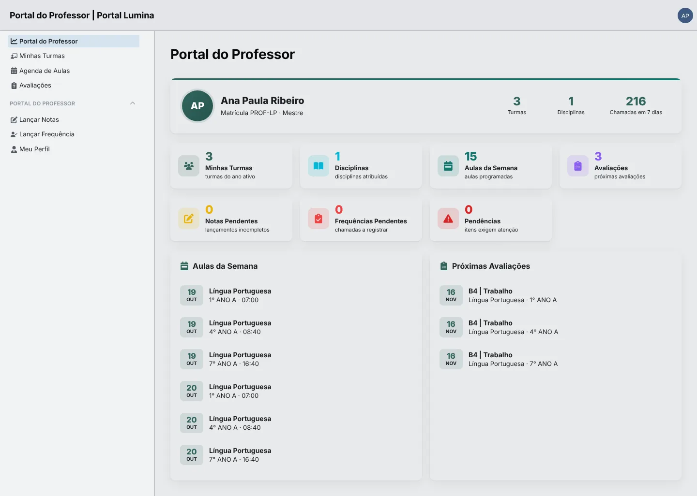
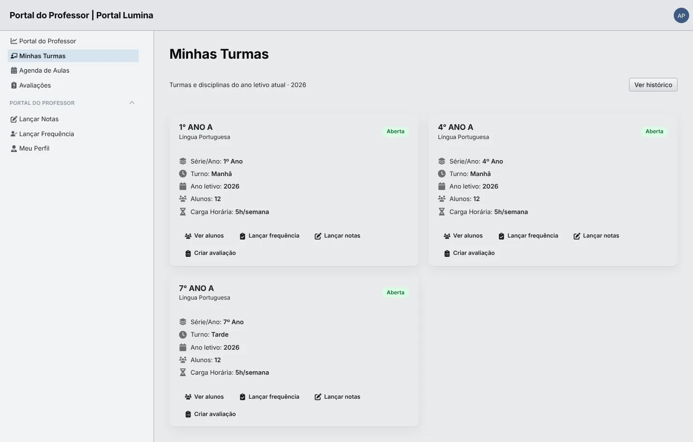
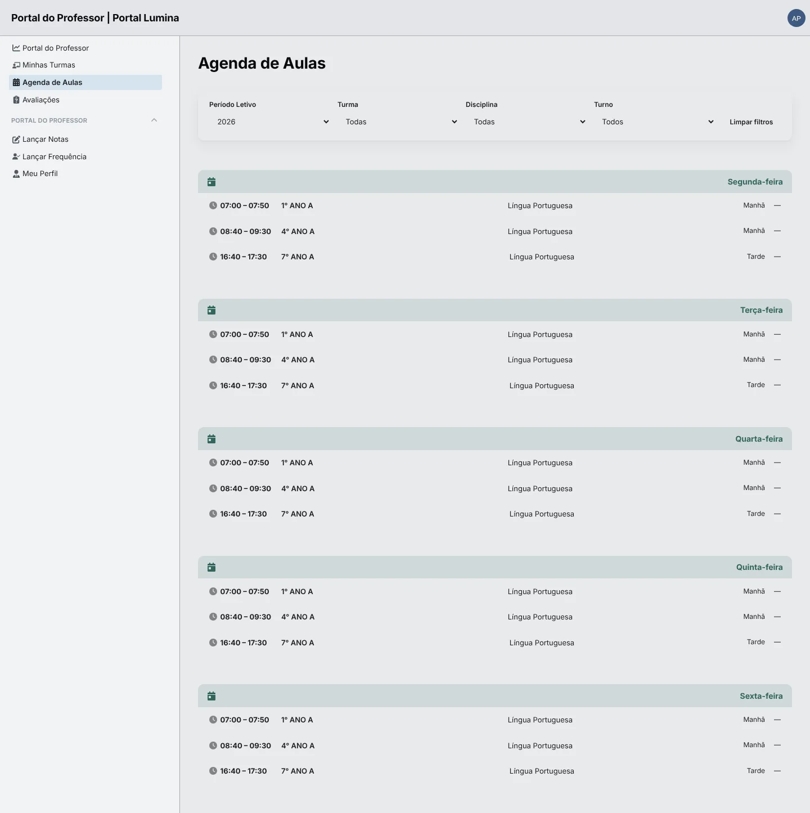
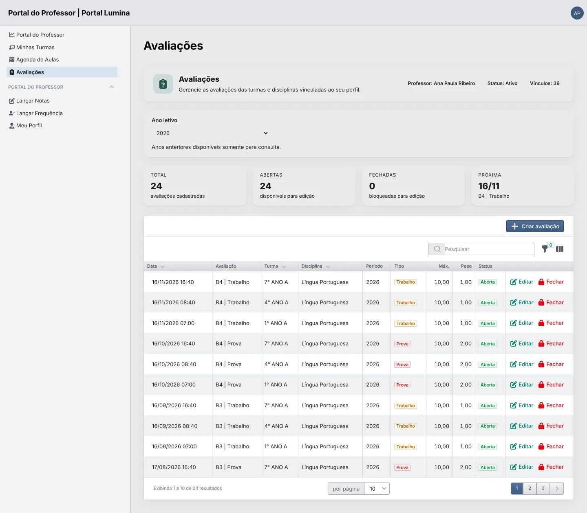
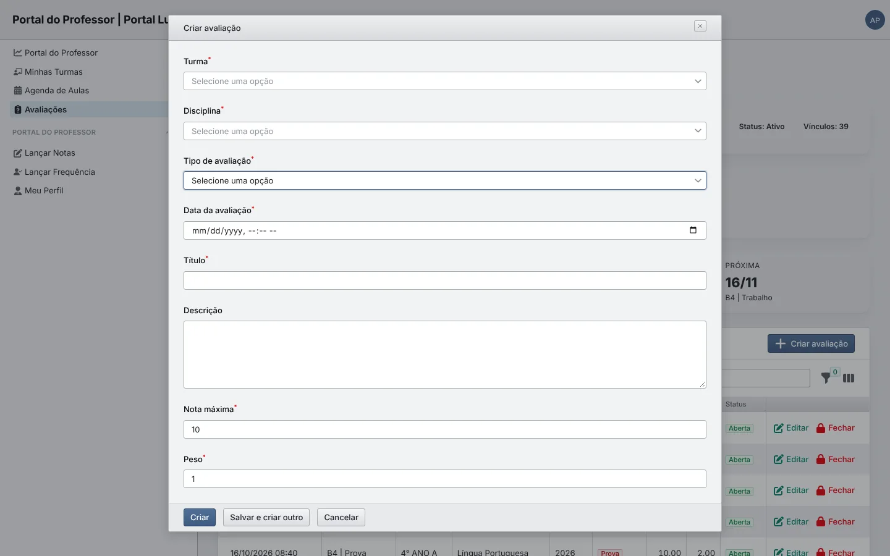
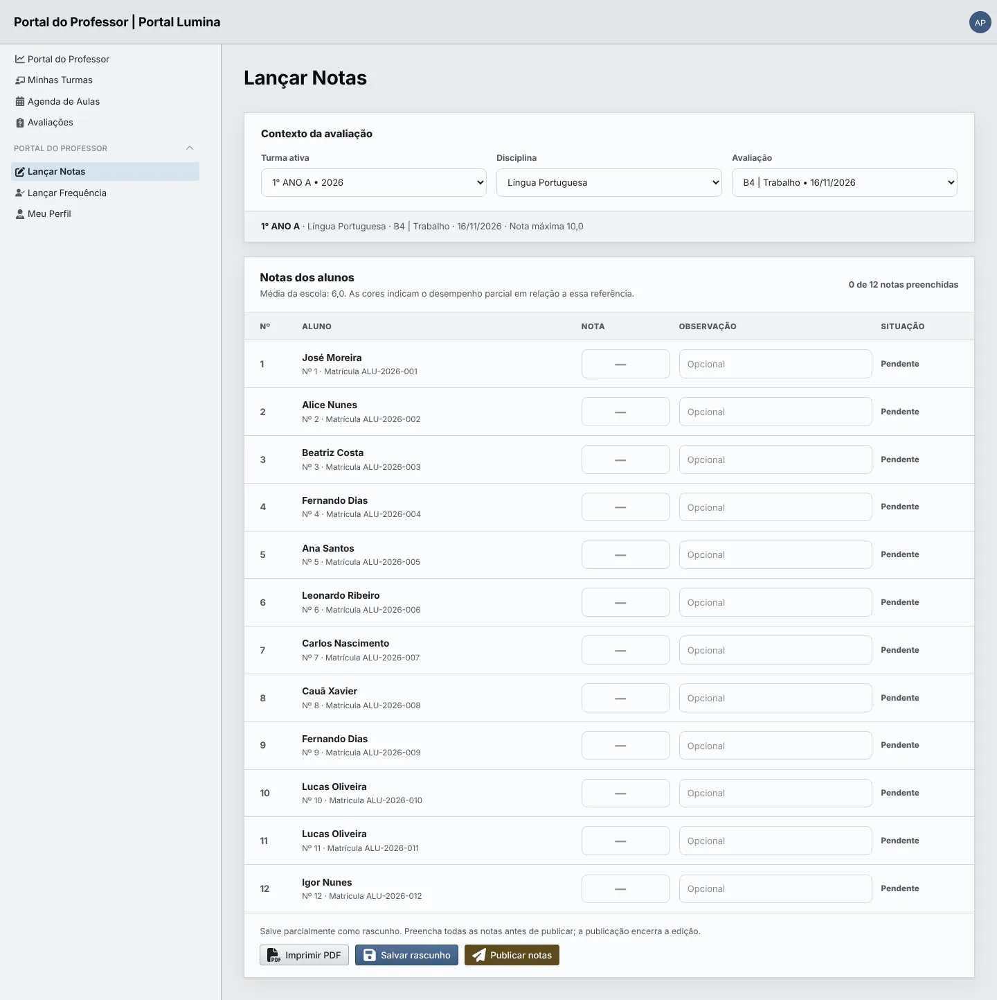
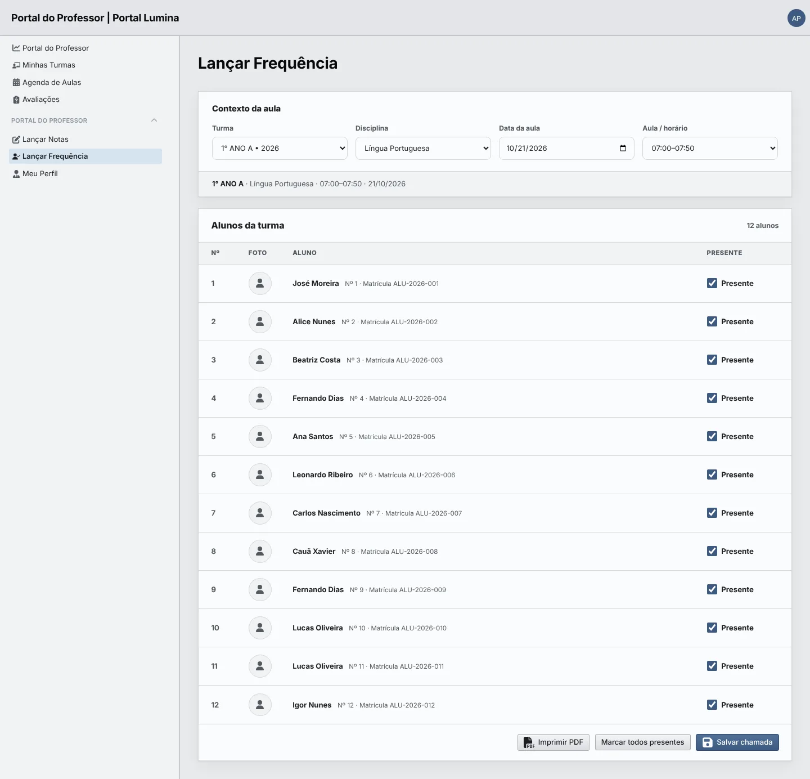
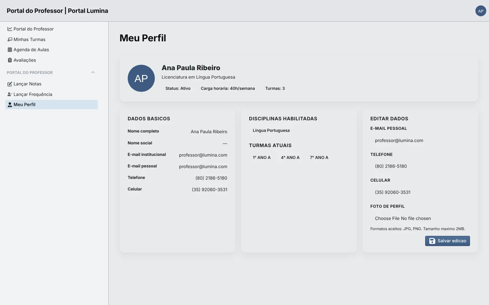

# Manual do portal do professor

> Guia de uso do portal do professor (`/professor`): turmas, agenda, avaliações, lançamento de notas e chamada.

## 🎯 Objetivo

O portal do professor é a área de trabalho do docente. Nele o professor consulta as turmas e a agenda do ano letivo, cria avaliações, lança e publica notas e registra a frequência das aulas. O professor **só vê as turmas e disciplinas em que está alocado** pela secretaria; ele não acessa cadastros administrativos.

**Endereço:** `/professor/login` · **Perfil:** `teacher`

Prints da base de demonstração, com dados sintéticos e data do sistema fixada em quarta-feira, 21/10/2026.

## 👥 Quem acessa

**[ 📢 REGRA DE NEGÓCIO ]** **Condições de acesso**

- Usuário ativo, desbloqueado e com o perfil `teacher`.
- Cadastro de professor com status **Ativo** e sem data de desligamento.
- Ao menos uma **alocação** (turma + disciplina) para ter turmas no portal.

O primeiro acesso costuma vir por convite enviado pela secretaria. Se algo estiver faltando, peça à secretaria para conferir o onboarding do professor em **Professores**. Detalhes em [Atores, perfis e portais](./atores-e-perfis.md).

## 🧭 Menu do portal

| Menu | Uso |
| --- | --- |
| Portal do Professor | Painel inicial |
| Minhas Turmas | Turmas e disciplinas do ano letivo |
| Agenda de Aulas | Grade semanal |
| Avaliações | Criar, editar e fechar avaliações |
| Lançar Notas | Notas por avaliação |
| Lançar Frequência | Chamada por aula |
| Meu Perfil | Dados pessoais e contato |

## 🖼️ Portal do Professor (painel)

Resumo do professor e da semana.

**[ 🖼️ VISUALIZAÇÃO ]**

| Área | O que mostra |
| --- | --- |
| Cabeçalho | Nome, matrícula funcional, titulação, número de turmas, disciplinas e chamadas dos últimos 7 dias |
| Cartões | Minhas turmas, disciplinas, aulas da semana, avaliações próximas, notas pendentes, frequências pendentes e pendências |
| Aulas da Semana | Próximas aulas com data, disciplina, turma e horário |
| Próximas Avaliações | Avaliações agendadas por data |

> [!TIP]
> Os cartões **Notas Pendentes** e **Frequências Pendentes** mostram o que ainda falta lançar. Comece o dia por eles.

## 🗂️ Minhas Turmas

Um cartão por turma e disciplina do ano letivo, com série, turno, ano, quantidade de alunos e carga horária semanal. Cada cartão tem atalhos para **Ver alunos**, **Lançar frequência**, **Lançar notas** e **Criar avaliação**. O botão **Ver histórico** mostra turmas de anos anteriores.

**[ 🖼️ VISUALIZAÇÃO ]**

## 📅 Agenda de Aulas

Grade semanal de segunda a sexta, com horário, turma, disciplina e turno de cada aula. Os filtros do topo limitam por **Período Letivo**, **Turma**, **Disciplina** e **Turno**; **Limpar filtros** volta à visão completa.

**[ 🖼️ VISUALIZAÇÃO ]**

## 📋 Avaliações

Lista as avaliações do professor no ano letivo escolhido, com data, título, turma, disciplina, período, tipo, nota máxima, peso e status. Os cartões mostram o total, quantas estão abertas (editáveis), quantas estão fechadas e a próxima avaliação.

**[ 🖼️ VISUALIZAÇÃO ]**

### Criar uma avaliação

1. Clique em **Criar avaliação** (ou no atalho do cartão da turma em **Minhas Turmas**).
2. Escolha **Turma** e **Disciplina** — só aparecem as suas alocações.
3. Informe **Tipo de avaliação** (Prova, Trabalho, Atividade, Seminário, Projeto, Recuperação ou Outro), **Data da avaliação** e **Título**.
4. Ajuste **Nota máxima** (padrão 10) e **Peso** (padrão 1). A **Descrição** é opcional.
5. Clique em **Criar**, ou **Salvar e criar outro** para cadastrar várias em sequência.

**[ 🖼️ VISUALIZAÇÃO ]**

**[ 📢 REGRA DE NEGÓCIO ]** **Peso** entra na média do bimestre. **Fechar** uma avaliação a bloqueia para edição. Anos letivos anteriores ficam disponíveis apenas para consulta.

## 📊 Lançar Notas

**[ 🖼️ VISUALIZAÇÃO ]**

1. Em **Contexto da avaliação**, escolha **Turma ativa**, **Disciplina** e **Avaliação**. A faixa abaixo confirma a seleção e a nota máxima.
2. Em **Notas dos alunos**, digite a **Nota** de cada aluno e, se quiser, uma **Observação**. As cores indicam o desempenho em relação à média da escola (6,0 na demonstração) e o contador mostra quantas notas já foram preenchidas.
3. Clique em **Salvar rascunho** para guardar sem mostrar ao aluno.
4. Com todas as notas preenchidas, clique em **Publicar notas**.
5. **Imprimir PDF** gera a lista de notas da avaliação.

> [!IMPORTANT]
> O aluno só vê notas **publicadas**. A publicação encerra a edição daquela avaliação, então confira tudo antes de publicar.

## 🙋 Lançar Frequência

**[ 🖼️ VISUALIZAÇÃO ]**

1. Em **Contexto da aula**, escolha **Turma**, **Disciplina**, **Data da aula** e **Aula / horário**. Sem uma aula programada para a data, a lista fica vazia e o sistema pede para conferir a seleção.
2. Em **Alunos da turma**, todos começam como **Presente**. Desmarque quem faltou, ou use **Marcar todos presentes** para restaurar.
3. Clique em **Salvar chamada**.
4. **Imprimir PDF** gera a lista de presença da aula.

**[ 📢 REGRA DE NEGÓCIO ]** A frequência do aluno considera presenças e atrasos sobre o total de aulas; o mínimo exigido é 75%.

## 👤 Meu Perfil

Mostra dados básicos, disciplinas habilitadas e turmas atuais. Em **Editar dados**, o professor pode atualizar **e-mail pessoal**, **telefone**, **celular** e **foto de perfil** (JPG ou PNG, até 2 MB) e clicar em **Salvar edição**. Nome, e-mail institucional e vínculo são alterados pela secretaria.

**[ 🖼️ VISUALIZAÇÃO ]**

## ⚠️ Limitações conhecidas

- A chamada registra apenas **presente** ou **ausente**; atraso e falta justificada não são lançados por esta tela.
- Não há páginas de diário de classe, conteúdo ministrado ou comunicados no portal.
- Notas publicadas não podem ser reabertas pelo professor.

## 🔗 Referências

- [Atores, perfis e portais](./atores-e-perfis.md)
- [Frequência — regras técnicas](./frequencia.md)
- [Manual do portal do aluno](./manual-portal-do-aluno.md)
- [Auditoria do portal do professor — 23/08/2026](../06-historico/2026-08-23-auditoria-portal-professor.md)
