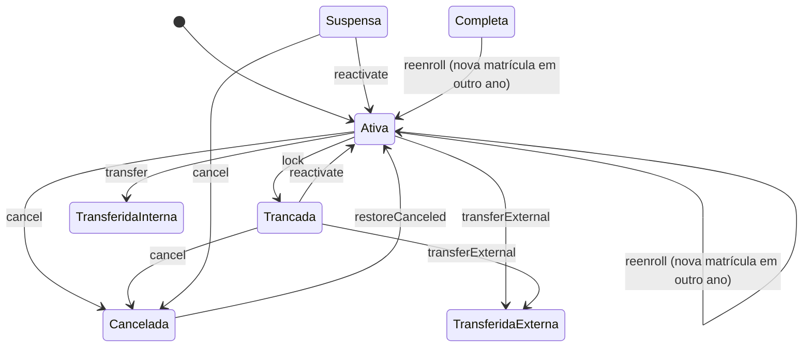

# Regras de matrícula

> Vínculo histórico do aluno com uma turma em um ano letivo, operado pela secretaria no painel `/lumina`.

## 🎯 Objetivo

Uma matrícula representa o vínculo histórico de um aluno com uma turma em um ano letivo. O histórico não deve ser apagado nem sobrescrito para registrar retorno, transferência, cancelamento ou rematrícula.

## 🗃️ Estados

| Status | Ocupa vaga | Observação |
| --- | --- | --- |
| Ativa | Sim | Única matrícula ativa permitida por aluno e ano letivo. |
| Suspensa | Sim | Pausa administrativa temporária. |
| Trancada | Sim | Pausa formal com motivo e prazo opcional. |
| Transferida Interna | Não | Encerra a matrícula de origem e cria nova matrícula ativa em outra turma do mesmo ano. |
| Transferida Externa | Não | Encerra o vínculo na instituição. |
| Cancelada | Não | Encerramento administrativo com motivo obrigatório. |
| Completa | Não | Encerramento regular do período letivo. |

## 🔄 Transições

**[ 🖼️ VISUALIZAÇÃO ]** Estados e operações de `StudentEnrollmentService` que os alteram. A lista de operações abaixo não documenta a entrada no status `Suspensa`.

Use `App\Services\Enrollments\StudentEnrollmentService` para todas as operações:

- `lock`: Ativa para Trancada;
- `reactivate`: Trancada ou Suspensa para Ativa;
- `cancel`: Ativa, Trancada ou Suspensa para Cancelada;
- `restoreCanceled`: Cancelada para Ativa por ação administrativa justificada;
- `transfer`: Ativa para Transferida Interna e nova matrícula Ativa no mesmo ano;
- `transferExternal`: Ativa ou Trancada para Transferida Externa;
- `reenroll`: Ativa ou Completa para nova matrícula Ativa em outro ano, com motivo registrado quando informado.

## 📢 Regras de negócio

**[ 📢 REGRA DE NEGÓCIO ]** **RN-MAT-001 — Matrícula ativa única**
A regra de negócio permite apenas uma matrícula `Ativa` por aluno e ano letivo. Matrículas históricas na mesma turma ou em turmas diferentes podem coexistir desde que não fiquem ativas simultaneamente no mesmo ano.

**[ 📢 REGRA DE NEGÓCIO ]** **RN-MAT-002 — Ocupação de vaga**
`Ativa`, `Suspensa` e `Trancada` ocupam vaga; os demais status liberam a vaga.

**[ 📢 REGRA DE NEGÓCIO ]** **RN-MAT-003 — Rastreabilidade**
Toda mudança de estado deve preencher `operated_by_user_id`, quando houver operador, e criar registro em `enrollment_logs`.
Onde: `App\Services\Enrollments\StudentEnrollmentService`
