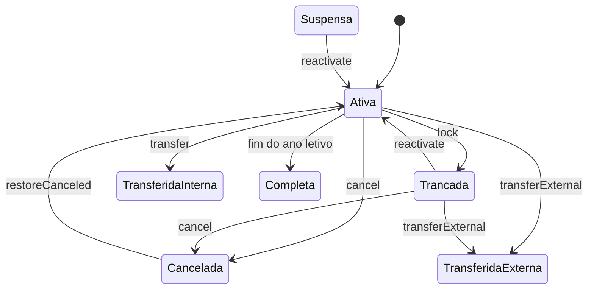

# Matrículas (exemplo)

> [!NOTE]
> Exemplo do template de módulo preenchido com as regras de [matrículas](../../04-modulos/matriculas.md). A fonte oficial continua sendo o documento do módulo.

## 🎯 Objetivo

Registrar o vínculo histórico de um aluno com uma turma em um ano letivo, sem apagar nem sobrescrever o histórico em retornos, transferências, cancelamentos ou rematrículas. **Fora do escopo:** cobrança e contratos (não há módulo financeiro).

## 👥 Perfis e acesso

| Perfil | Entrada | Pode | Não pode |
| --- | --- | --- | --- |
| Secretaria | `/lumina/login` | Criar, trancar, reativar, transferir, cancelar | Apagar histórico |
| Aluno | `/aluno/login` | Ver dados da matrícula ativa | Ver matrícula de outro aluno |

## 🔄 Fluxo

**[ 🖼️ VISUALIZAÇÃO ]** Estados da matrícula e as operações de `StudentEnrollmentService` que os alteram.

| Situação alternativa | Comportamento | Mensagem ao usuário |
| --- | --- | --- |
| Turma sem vaga | Rejeita, não cria matrícula | Aviso de capacidade |
| Ano letivo encerrado | Rejeita, não cria matrícula | Mensagem explícita de ano encerrado |

## 📢 Regras de negócio

**[ 📢 REGRA DE NEGÓCIO ]** **RN-MAT-001 — Matrícula ativa única**
Apenas uma matrícula `Ativa` por aluno e ano letivo. Matrículas históricas podem coexistir se não estiverem ativas ao mesmo tempo.

**[ 📢 REGRA DE NEGÓCIO ]** **RN-MAT-002 — Ocupação de vaga**
`Ativa`, `Suspensa` e `Trancada` ocupam vaga; os demais status liberam.

**[ 📢 REGRA DE NEGÓCIO ]** **RN-MAT-003 — Rastreabilidade**
Toda mudança de estado preenche `operated_by_user_id` (quando houver operador) e cria registro em `enrollment_logs`.
Onde: `App\Services\Enrollments\StudentEnrollmentService`

## 🗃️ Dados

**[ 🛠️ ESTRUTURA ]**

| Tabela | Uso no módulo | Restrições |
| --- | --- | --- |
| `enrollments` | Vínculo aluno–turma–ano | Uma ativa por aluno/ano |
| `enrollment_logs` | Histórico de operações | FK restrita (não apaga com a matrícula) |
| `enrollment_documents` | Documentos emitidos | — |

## ⚠️ Limitações conhecidas

- Envio real de e-mail ainda não ensaiado (`MAIL_MAILER=log`).

## 🚀 Evolução

> [!NOTE]
> Propostas, ainda não implementadas.

- Registrar as regras acima também como testes nomeados por ID (`test_rn_mat_001_...`).
