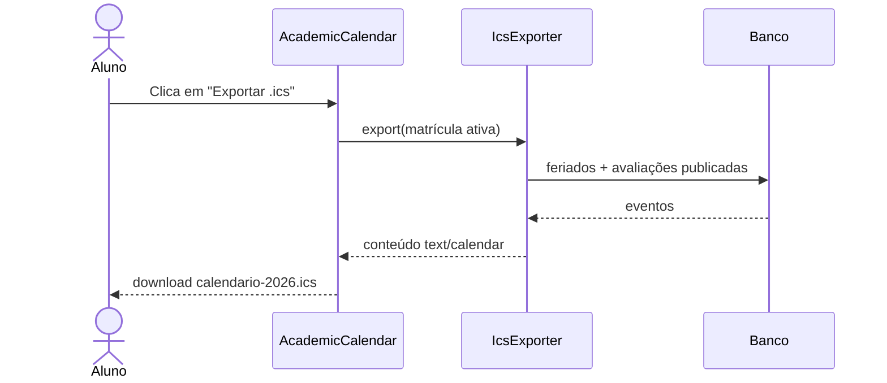

# LUM-123 — Exportar calendário acadêmico em iCalendar (exemplo)

ESTA TAREFA PRECISA DE DOCUMENTAÇÃO

> **Módulo:** Portal do aluno · **Tipo:** funcionalidade · **Prioridade:** média
> Exemplo do template de tarefa. Código e números fictícios; o contexto vem do relatório de prontidão.

🎯 <b>OBJETIVO</b>

## 🎯 Objetivo

Permitir que o aluno baixe o calendário acadêmico do ano ativo em formato `.ics` para importar no Google Agenda ou Outlook.

**[ 📝 CONTEXTO ]** A página `AcademicCalendar` exibe as ações de PDF e iCalendar, mas hoje elas apenas notificam “em breve”. O relatório de prontidão pede implementar ou remover essas ações.

🗂️ <b>CRITÉRIOS PRELIMINARES</b>

## 🗂️ Critérios preliminares

- **Dentro do escopo:** exportação `.ics` do ano letivo ativo do aluno logado.
- **Fora do escopo:** exportação em PDF (tarefa separada), assinatura por URL.
- **Dependências:** dias não letivos em `school_holidays`; avaliações publicadas.

📒 <b>DETALHAMENTO TÉCNICO</b>

## 📒 Detalhamento técnico

**[ 📢 REGRA DE NEGÓCIO ]** **RN-ALU-013** — O arquivo contém apenas eventos do ano letivo ativo e da turma da matrícula ativa do aluno.

**[ 📢 REGRA DE NEGÓCIO ]** **RN-ALU-014** — Avaliações só entram no arquivo depois de publicadas.

**[ 🛠️ ESTRUTURA ]**

| Camada | Arquivo | Alteração |
| --- | --- | --- |
| Página | `app/Filament/Pages/Student/AcademicCalendar.php` | Ação chama o serviço e devolve download |
| Serviço | `app/Services/Calendar/IcsExporter.php` | Novo: monta VCALENDAR/VEVENT |
| Teste | `tests/Feature/Student/CalendarExportTest.php` | Novo |

**[ 🖼️ VISUALIZAÇÃO ]** Sequência da exportação.

📋 <b>REFINAMENTO TÉCNICO</b>

## 📋 Refinamento técnico

| Dúvida / decisão | Resposta | Quem decidiu |
| --- | --- | --- |
| Gerar com biblioteca ou à mão? | Biblioteca, para escapar texto e fuso corretamente | — |
| Fuso horário | `America/Sao_Paulo` | — |

🧪 <b>CASOS DE TESTES</b>

## 🧪 Casos de testes

| ID | Cenário | Dado | Esperado | Tipo |
| --- | --- | --- | --- | --- |
| CT-01 | Aluno com matrícula ativa | 2 feriados, 1 avaliação publicada | `.ics` com 3 eventos | Feature |
| CT-02 | Avaliação em rascunho | 1 avaliação sem `locked_at` | Não aparece no arquivo | Feature |
| CT-03 | Usuário sem papel de aluno | professor logado | Acesso negado | Authorization |

✅ <b>CRITÉRIOS DE ACEITE</b>

## ✅ Critérios de aceite

- [ ] Arquivo importa sem erro no Google Agenda e no Outlook.
- [ ] CT-01 a CT-03 passando no contêiner.
- [ ] `docs/04-modulos/portal-do-aluno.md` atualizado com RN-ALU-013 e RN-ALU-014.

🌐 <b>INFORMAÇÕES COMPLEMENTARES</b>

## 🌐 Informações complementares

- [Relatório de prontidão](../../05-qualidade/relatorio-prontidao.md) — item “exportações expostas mas ainda não implementadas”.
- RFC 5545 (iCalendar).
