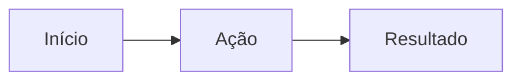

# Nome do módulo

> Uma frase dizendo o que o módulo faz e para quem.

## 1. Objetivo e escopo

O que o módulo cobre. **Fora do escopo:** o que não cobre e onde isso está (ou se não existe).

## 2. Perfis e acesso

| Perfil | Entrada | Pode | Não pode |
| --- | --- | --- | --- |
| | `/rota/login` | | |

Permissões envolvidas: `modulo.acao`, `modulo.acao`. Policies/Gates: `App\Policies\...`.

## 3. Fluxo principal

1. Passo, com a tela ou rota envolvida.
2. Passo.

### Fluxos alternativos e erros

| Situação | Comportamento esperado | Mensagem ao usuário |
| --- | --- | --- |
| | | |

## 4. Regras de negócio

### RN-XXX-001 — Nome curto

**Regra:** enunciado verificável.
**Onde:** `app/Services/...` · **Teste:** `tests/Feature/...`

## 5. Dados

| Tabela | Uso no módulo | Restrições relevantes |
| --- | --- | --- |
| | | unique, FK, soft delete |

Detalhes de colunas ficam no [modelo relacional](../03-arquitetura/modelo-relacional.md).

## 6. Arquivos principais

| Camada | Arquivo |
| --- | --- |
| Página/Resource Filament | `app/Filament/...` |
| Serviço | `app/Services/...` |
| Model | `app/Models/...` |
| Testes | `tests/Feature/...` |

## 7. Requisitos não funcionais

- **RNF-XXX-001 — Segurança:** ...
- **RNF-XXX-002 — Desempenho:** ...

## 8. Limitações conhecidas

- Limitação atual, com link para issue quando houver.

## 9. Evolução (proposta, não implementado)

- Item de backlog.
