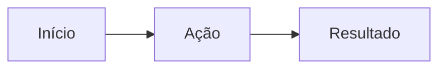

# Nome do módulo

> Uma frase dizendo o que o módulo faz e para quem.

## 🎯 Objetivo

O que o módulo cobre. **Fora do escopo:** o que não cobre e onde isso está (ou se não existe).

## 👥 Perfis e acesso

| Perfil | Entrada | Pode | Não pode |
| --- | --- | --- | --- |
| | `/rota/login` | | |

Permissões: `modulo.acao`. Policies/Gates: `App\Policies\...`.

## 🔄 Fluxo

**[ 🖼️ VISUALIZAÇÃO ]** O que o diagrama mostra.

1. Passo, com a tela ou rota envolvida.

| Situação alternativa | Comportamento | Mensagem ao usuário |
| --- | --- | --- |
| | | |

## 📢 Regras de negócio

**[ 📢 REGRA DE NEGÓCIO ]** **RN-XXX-001 — Nome curto**
Enunciado verificável.
Onde: `app/Services/...` · Teste: `tests/Feature/...`

## 🗃️ Dados

| Tabela | Uso no módulo | Restrições |
| --- | --- | --- |
| | | unique, FK, soft delete |

Colunas no [modelo relacional](../03-arquitetura/modelo-relacional.md).

## 📁 Arquivos principais

**[ 🛠️ ESTRUTURA ]**

| Camada | Arquivo |
| --- | --- |
| Página/Resource Filament | `app/Filament/...` |
| Serviço | `app/Services/...` |
| Model | `app/Models/...` |
| Testes | `tests/Feature/...` |

## ⚙️ Requisitos não funcionais

- **RNF-XXX-001 — Segurança:** …

## ⚠️ Limitações conhecidas

- …

## 🚀 Evolução

> [!NOTE]
> Propostas, ainda não implementadas.

- …
