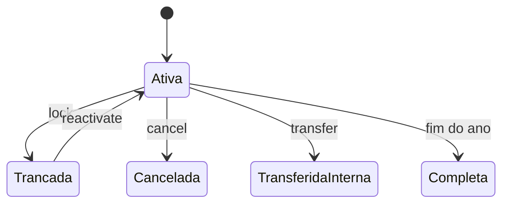

# Padrão de formatação Markdown

> Como escrever qualquer `.md` do Lumina ERP: emojis, blocos HTML da empresa, avisos e diagramas. Os [templates](./README.md) já seguem este padrão; os [exemplos](./exemplos/) mostram cada tipo preenchido.

## 🧭 Princípio: três camadas

O mesmo arquivo é lido no **GitHub**, no **preview do PhpStorm** e, quando é tarefa, nas **tarefas da empresa**. O GitHub remove o atributo `style` do HTML, então cores e fundos somem lá. Por isso a formatação é feita em camadas, e cada camada continua legível quando a seguinte não renderiza:

| Camada | Recurso | GitHub | PhpStorm | Tarefas da empresa | Uso |
| --- | --- | :---: | :---: | :---: | --- |
| 1. Estrutura | `## 🎯 Título` com emoji | ✅ | ✅ | ✅ | **Obrigatória.** Gera âncora, sumário e outline |
| 2. Destaque | `<span>` com rótulo `[ 📢 … ]` | ⚠️ sem cor, mantém negrito e emoji | ✅ | ✅ | Marcar trechos dentro de uma seção |
| 3. Faixa | `<div>` colorido da empresa | ⚠️ vira texto simples | ✅ | ✅ | Só em tarefas, bugs e reuniões |

**Regra prática:** o significado vem sempre do **emoji + palavra**; a cor é só um reforço. Assim nada se perde quando a cor some.

## 🗂️ Qual estilo em cada tipo de arquivo

| Tipo | Pasta | Títulos com emoji | Rótulos `<span>` | Faixas `<div>` | Avisos `> [!…]` | Mermaid |
| --- | --- | :---: | :---: | :---: | :---: | :---: |
| README / índice | raiz, `docs/` | H2 | — | — | ✅ | opcional |
| Módulo | `04-modulos/` | H2 | ✅ regras, estrutura | — | ✅ | ✅ fluxo e estados |
| Guia | `02-guias/` | H2 | — | — | ✅ | raro |
| ADR | `03-arquitetura/adr/` | H2 | — | — | — | opcional |
| Auditoria / validação | `05-`, `06-` | H2 | ✅ | — | ✅ | opcional |
| Tarefa, bug, reunião | colado nas tarefas da empresa ou `.dev-tasks/` | H2 | ✅ | ✅ | ✅ status | ✅ |

## 😀 Dicionário de emojis

Use **um emoji por título H2**, sempre o mesmo para o mesmo tipo de seção. H1 e H3 ficam sem emoji. Não use emoji no meio de frases. Em seções numeradas, o emoji vem antes do número: `## 🎯 1. Objetivo do módulo`.

| Emoji | Seção | Emoji | Seção |
| :---: | --- | :---: | --- |
| 🎯 | Objetivo | 📝 | Contexto |
| 📢 | Regra de negócio | 🛠️ | Estrutura / arquitetura |
| 🖼️ | Visualização / telas | 🗂️ | Critérios preliminares / escopo |
| 📒 | Detalhamento técnico | ✅ | Critérios de aceite |
| 🌐 | Informações complementares | 📋 | Refinamento técnico |
| 🔍 | Análise | 🧪 | Casos de teste |
| 🤔 | Descritivo do problema | 🫵 | Propostas de desenvolvimento |
| 🤝 | Reunião | 👥 | Perfis e acesso |
| 🔄 | Fluxo | 🗃️ | Dados / banco |
| 📁 | Arquivos principais | ⚙️ | Requisitos (funcionais e não funcionais) |
| ⚠️ | Limitações conhecidas | 🚀 | Evolução / backlog |
| 📦 | Pré-requisitos | ▶️ | Passo a passo |
| 🩺 | Problemas comuns | ↩️ | Rollback |
| 🔗 | Referências / links | 🧭 | Sumário / comece aqui |
| 🔐 | Segurança / autenticação | 🚦 | Estado atual |
| ⚖️ | Decisão / consequências | 🏁 | Conclusão |
| ✍️ | Contribuição / escrita | 📅 📌 | Data e tema (reunião) |

### Emojis em manuais de uso

Nos manuais de cada portal, as seções seguem o nome do menu e usam estes emojis:

| Emoji | Tela | Emoji | Tela |
| :---: | --- | :---: | --- |
| 🖼️ | Painel / tela inicial | 🗂️ | Listas e cadastros (turmas, disciplinas) |
| 📊 | Notas, boletim e indicadores | 🙋 | Frequência e chamada |
| 📅 | Agenda e calendário | 📋 | Avaliações |
| 👤 | Perfil do usuário | 🧭 | Menu do portal |
| ⚙️ | Administração e parametrizações | 🔐 | Segurança e permissões |

## 🏷️ Rótulos inline (camada 2)

Para marcar um trecho dentro de uma seção. Use exatamente o HTML da empresa:

| Rótulo | Quando usar |
| --- | --- |
| <span style="color: #c0392b;">**[ 📢 REGRA DE NEGÓCIO ]**</span> | Antes de uma regra com ID `RN-…` |
| <span style="color: #2980b9;">**[ 🛠️ ESTRUTURA ]**</span> | Antes de tabela, classe ou trecho de código estrutural |
| <span style="color: #009432;">**[ 🖼️ VISUALIZAÇÃO ]**</span> | Antes de print, diagrama ou descrição de tela |
| <span style="color: #8e44ad;">**[ 📝 CONTEXTO ]**</span> | Antes de explicação de motivo ou histórico |

```html
<span style="color: #c0392b;">**[ 📢 REGRA DE NEGÓCIO ]**</span> **RN-MAT-001** — Apenas uma matrícula ativa por aluno e ano letivo.
```

## 🎨 Faixas de seção (camada 3)

Somente em **tarefa, bug e reunião**. Cada faixa vem **logo acima** do título H2 correspondente, para manter âncora e outline:

```html
<div style="background: #f4dfe5; border-style: double; color: #b71540; padding: 5px; text-align: center; border-color: #b71540;">🎯 <b>OBJETIVO</b></div>

## 🎯 Objetivo
```

> [!IMPORTANT]
> Deixe **uma linha em branco depois do `</div>`**. Sem ela, o Markdown seguinte é tratado como parte do bloco HTML e não renderiza (negrito, listas e links aparecem crus).

<details>
<summary><b>Catálogo completo das faixas da empresa</b> (clique para abrir)</summary>

| Faixa | Fundo | Cor |
| --- | --- | --- |
| 🎯 OBJETIVO | `#f4dfe5` | `#b71540` |
| 🗂️ CRITÉRIOS PRELIMINARES | `#f1e3ec` | `#6F1E51` |
| 📒 DETALHAMENTO TÉCNICO | `#dfe6e9` | `#2d3436` |
| ✅ CRITÉRIOS DE ACEITE | `#e1efe6` | `#009432` |
| 🌐 INFORMAÇÕES COMPLEMENTARES | `#e8f4f8` | `#1e3a8a` |
| 📋 REFINAMENTO TÉCNICO | `#f8e6ff` | `#8e44ad` |
| 🔍 ANÁLISE | `#fcebbd` | `#d69a2e` |
| 🧪 CASOS DE TESTES | `#e0f7fa` | `#00796b` |
| 🤔 DESCRITIVO DO PROBLEMA | `#e0f7fa` | `#00796b` |
| 🫵 PROPOSTAS DE DESENVOLVIMENTO | `#f1e3ec` | `#6F1E51` |
| 🤝 REUNIÃO | `#d1f1e5` | `#16a085` |

Todas usam o mesmo molde: `background`, `border-style: double`, `color`, `border-color` iguais à cor, `padding: 5px; text-align: center;`.

</details>

## 🚦 Status da tarefa

As três faixas de status da empresa têm equivalente nativo no GitHub. Use a faixa nas tarefas e o aviso nos documentos do repositório:

| Situação | Tarefas da empresa | Documentos no GitHub |
| --- | --- | --- |
| Travada, precisa sanar dúvidas | `<div style="background-color: #c0392b; color: white; …">` | `> [!CAUTION]` |
| Precisa de documentação | `<div style="background: #8e44ad; color: white; …">` | `> [!WARNING]` |
| Dúvidas sanadas | `<div style="background: #2980b9; color: white; …">` | `> [!TIP]` |

Avisos disponíveis no GitHub: `[!NOTE]` informação útil, `[!TIP]` dica, `[!IMPORTANT]` essencial, `[!WARNING]` atenção, `[!CAUTION]` risco. Um aviso por bloco, no máximo dois ou três por documento.

## 🧩 Outros recursos HTML permitidos

O GitHub aceita estes elementos sem `style`, e eles funcionam em todos os destinos:

| Elemento | Uso | Exemplo |
| --- | --- | --- |
| `<details><summary>` | Conteúdo longo recolhível (logs, catálogos, SQL) | ver catálogo acima |
| `<kbd>` | Teclas e atalhos | <kbd>Ctrl</kbd> + <kbd>Shift</kbd> + <kbd>F</kbd> |
| `<sub>` | Nota pequena abaixo de tabela ou imagem | <sub>Dados sintéticos.</sub> |
| `<br>` | Quebra dentro de célula de tabela | — |
| `` | Imagem com largura controlada | `` |

Evite `<font>`, `<center>`, `<table>` em HTML (use tabela Markdown) e `<script>`/`<iframe>` (removidos).

## 🔄 Diagramas Mermaid

| Para mostrar | Tipo |
| --- | --- |
| Fluxo de tela ou processo | `flowchart LR` (ou `TD` se for vertical) |
| Status e transições | `stateDiagram-v2` |
| Tabelas e relações | `erDiagram` |
| Chamadas entre camadas | `sequenceDiagram` |
| Cronograma e marcos | `gantt` |

Regras:

- Rótulos em português, até ~15 nós por diagrama; se passar disso, divida.
- Não defina cores, `classDef` ou `%%{init: theme}%%`: o GitHub alterna claro/escuro e cores fixas ficam ilegíveis.
- Anteceda o diagrama com o rótulo <span style="color: #009432;">**[ 🖼️ VISUALIZAÇÃO ]**</span> e uma frase dizendo o que ele mostra.
- O diagrama complementa o texto, não o substitui: a regra precisa estar escrita também.



## 📚 Histórico dentro do documento

Documentos que acumulam rodadas (validação, prontidão) começam com `## 🚦 Estado atual`: uma tabela curta com a situação vigente. As rodadas vêm abaixo, da mais recente para a mais antiga, e as rodadas superadas ficam dentro de `<details>`.

## ✍️ Texto, tabelas e código

- Português formal e direto; termos de código entre crases: `StudentEnrollmentService`, `locked_at`.
- **Negrito** só para o que o leitor não pode perder. Sem itálico para ênfase.
- Tabelas com cabeçalho curto; números alinhados à direita (`---:`).
- Todo bloco de código com linguagem: `bash`, `php`, `sql`, `json`, `yaml`, `html`, `mermaid`, `text`.
- Comandos de terminal sem `$` no início, para poder copiar.
- Datas: `DD/MM/AAAA` no texto, `AAAA-MM-DD` em metadados e nomes de arquivo.
- Linha horizontal `---` só para separar partes realmente distintas; títulos já separam seções.

## 🚫 Não faça

| Evite | Prefira |
| --- | --- |
| `# 📅 Data` repetido (vários H1) | um H1 e seções `## 📅 Data` |
| Faixa `<div>` sem título H2 abaixo | faixa + `## 🎯 Objetivo` |
| Cor como única informação | emoji + palavra |
| Emojis decorativos em frases e listas | um emoji por título |
| Mermaid com cores personalizadas | tema padrão |
| Senha, token, IP ou dado real de aluno | dados sintéticos e `<placeholder>` |

## 🔗 Sugestões para o padrão da empresa

- **CASOS DE TESTES** e **DESCRITIVO DO PROBLEMA** usam as mesmas cores, assim como **CRITÉRIOS PRELIMINARES** e **PROPOSTAS DE DESENVOLVIMENTO**. Sugestão para o problema: fundo `#fdebd0`, cor `#ba4a00`; para propostas: fundo `#e8eaf6`, cor `#283593`.
- O modelo de reunião usa vários `#` (H1). Trocar por `##` mantém um único título por documento e melhora o sumário.
- Padronizar espaços no `style` (`padding: 5px; text-align: center;`), hoje há variações.
