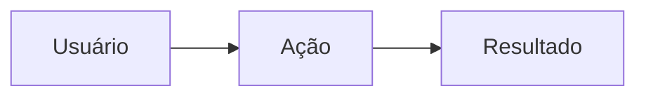

# CODIGO — Título da tarefa

<!-- Status (opcional): cole uma das faixas abaixo no topo quando aplicável e apague as demais.

<b>TAREFA TRAVADA, PRECISA SANAR DÚVIDAS</b>

ESTA TAREFA PRECISA DE DOCUMENTAÇÃO

👍 DÚVIDAS SANADAS, OBRIGADO!

-->

> **Módulo:** módulo · **Tipo:** funcionalidade | melhoria · **Prioridade:** alta | média | baixa

🎯 <b>OBJETIVO</b>

## 🎯 Objetivo

O que deve ser entregue e para quem, em uma ou duas frases.

**[ 📝 CONTEXTO ]** Por que a tarefa existe agora (pedido, falha, limitação).

🗂️ <b>CRITÉRIOS PRELIMINARES</b>

## 🗂️ Critérios preliminares

- **Dentro do escopo:** …
- **Fora do escopo:** …
- **Dependências:** …

📒 <b>DETALHAMENTO TÉCNICO</b>

## 📒 Detalhamento técnico

**[ 📢 REGRA DE NEGÓCIO ]** **RN-XXX-001** — Enunciado verificável.

**[ 🛠️ ESTRUTURA ]**

| Camada | Arquivo | Alteração |
| --- | --- | --- |
| Serviço | `app/Services/...` | |
| Página Filament | `app/Filament/...` | |
| Teste | `tests/Feature/...` | |

**[ 🖼️ VISUALIZAÇÃO ]** O que muda na tela ou no fluxo.

📋 <b>REFINAMENTO TÉCNICO</b>

## 📋 Refinamento técnico

| Dúvida / decisão | Resposta | Quem decidiu |
| --- | --- | --- |
| | | |

🧪 <b>CASOS DE TESTES</b>

## 🧪 Casos de testes

| ID | Cenário | Dado | Esperado | Tipo |
| --- | --- | --- | --- | --- |
| CT-01 | Caminho feliz | | | Feature |
| CT-02 | Sem permissão | | 403 / redirect | Authorization |
| CT-03 | Dado inválido | | mensagem de validação | Feature |

✅ <b>CRITÉRIOS DE ACEITE</b>

## ✅ Critérios de aceite

- [ ] Critério observável 1.
- [ ] Testes CT-01 a CT-03 passando no contêiner.
- [ ] Documento do módulo atualizado.

🌐 <b>INFORMAÇÕES COMPLEMENTARES</b>

## 🌐 Informações complementares

- PR: …
- Documentação: `docs/04-modulos/...`
